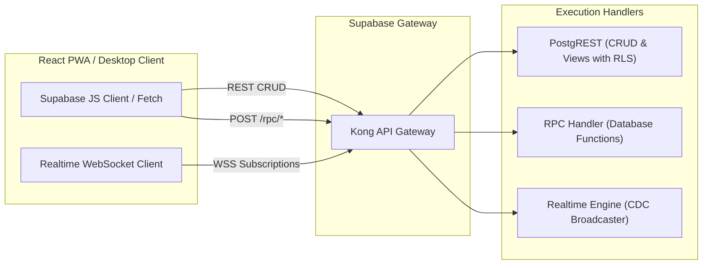
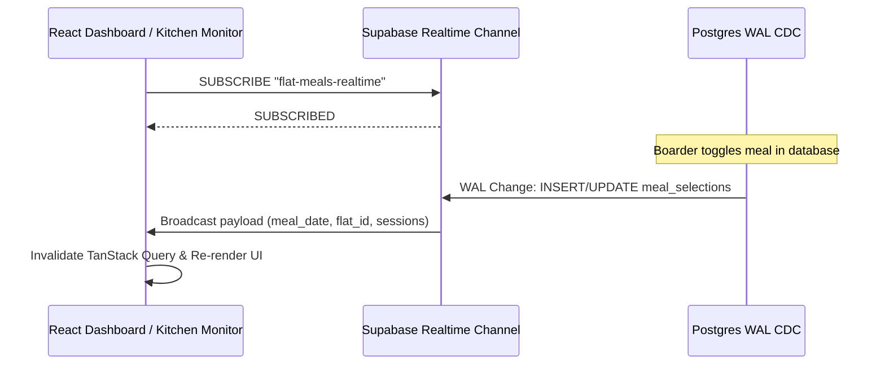

# Bachelor Home ERP — API Contracts & Integration Specification
**Version:** 1.0  
**Status:** Approved Engineering Interface  
**Protocol:** REST (PostgREST) + RPC (PostgreSQL Stored Procedures) + WebSockets (Supabase Realtime)  
**Standard Timezone:** `Asia/Dhaka` (UTC+6)  
**Standard Currency:** BDT (`NUMERIC(12,2)`)  
**Derived From:** PRD v3.0 & Technical Architecture Document  

---

## 1. API Architecture & Standards

The application communicates with the backend via three interface paradigms:
1. **PostgREST RESTful Endpoints:** Standard CRUD and filtering against database tables and analytical views, strictly enforced by Row Level Security (RLS).
2. **Supabase RPC (Remote Procedure Calls):** Transactional multi-step business logic (receipt posting, meal cutoffs, daily cash closings, handovers) executed as PostgreSQL `SECURITY DEFINER` functions.
3. **Supabase Realtime (WebSockets / CDC):** Push subscriptions for instant dashboard and kitchen list updates.



### 1.1 Standard Request Headers
```http
Authorization: Bearer <JWT_ACCESS_TOKEN>
apikey: <SUPABASE_ANON_KEY>
Content-Type: application/json
Accept: application/json
Prefer: return=representation -- (Optional: returns created/updated entity)
```

### 1.2 Standard Response Envelopes
#### Success Response (REST / PostgREST)
```json
[
  {
    "id": "7c9b2f6b-8a2b-4b7e-971c-3b03610a8b9f",
    "seat_code": "S-101-A",
    "default_rent": 4500.00,
    "status": "AVAILABLE"
  }
]
```

#### RPC Standard Envelope
```json
{
  "success": true,
  "message": "Operation completed successfully.",
  "data": { ... }
}
```

#### Standard Error Envelope (PostgREST & PostgreSQL Exceptions)
```json
{
  "code": "42501",
  "details": null,
  "hint": null,
  "message": "10:00 PM cutoff reached. Next-day meal changes are locked."
}
```

---

## 2. PostgREST RESTful Endpoints

All standard REST endpoints support filtering operators (`eq`, `neq`, `gt`, `gte`, `lt`, `lte`, `in`, `is`, `order`, `limit`, `offset`).

### 2.1 Accommodation Inventory Endpoints

#### `GET /rest/v1/buildings`
- **Query Params:** `select=*,flats(*,rooms(*,seats(*)))&status=eq.ACTIVE`
- **Permissions:** Super Admin, Admin, Accountant, Auditor; Managers (assigned flats only).
- **Response `200 OK`:**
```json
[
  {
    "id": "a1b2c3d4-e5f6-7a8b-9c0d-1e2f3a4b5c6d",
    "building_code": "BLD-01",
    "name": "Sunflower Hostel",
    "address": "House 12, Road 5, Dhanmondi, Dhaka",
    "status": "ACTIVE",
    "flats": [
      {
        "id": "f1e2d3c4-b5a6-7890-1234-56789abcdef0",
        "flat_code": "FLAT-2A",
        "name": "Flat 2A",
        "floor_number": 2
      }
    ]
  }
]
```

#### `GET /rest/v1/seats`
- **Query Params:** `select=id,seat_code,seat_name,default_rent,status,rooms(id,name,flats(id,name))&status=eq.AVAILABLE`
- **Permissions:** Admin, Manager.
- **Response `200 OK`:** Array of available seats for allocation.

---

### 2.2 Boarder & Application Endpoints

#### `POST /rest/v1/boarders` (Self-Registration by Applicant)
- **Permissions:** `APPLICANT` role only (Enforced via RLS).
- **Request Body:**
```json
{
  "full_name": "Tanvir Hasan",
  "phone_number": "01711000000",
  "email": "tanvir@example.com",
  "nid_passport_number": "199826926000000",
  "student_id": "CSE-2022-01",
  "institution": "University of Dhaka",
  "department": "Computer Science & Engineering",
  "guardian_name": "Rafiqul Islam",
  "guardian_phone": "01811000000",
  "guardian_relation": "Father",
  "permanent_address": "Vill: Rampur, Post: Sadar, Feni",
  "present_address": "Dhaka",
  "admission_date": "2026-11-01",
  "status": "PENDING"
}
```
- **Response `201 Created`:** Created boarder entity.

#### `GET /rest/v1/boarders` (Admin / Manager Directory)
- **Query Params:** `select=*,allocations(*,seats(*))&status=eq.ACTIVE&order=full_name.asc`
- **Permissions:** Admin, Manager (Assigned flats), Accountant, Auditor.

---

### 2.3 Financial Billing & Reporting Views

#### `GET /rest/v1/vw_boarder_dues_summary`
- **Query Params:** `select=*&total_outstanding_due=gt.0&order=total_outstanding_due.desc`
- **Response `200 OK`:**
```json
[
  {
    "boarder_id": "9a8b7c6d-5e4f-3a2b-1c0d-e2f3a4b5c6d7",
    "boarder_code": "B-2026-042",
    "full_name": "Tanvir Hasan",
    "phone_number": "01711000000",
    "flat_name": "Flat 2A",
    "seat_name": "Seat A-1",
    "total_billed": 6500.00,
    "total_paid": 4000.00,
    "total_outstanding_due": 2500.00,
    "overdue_amount": 2500.00
  }
]
```

#### `GET /rest/v1/vw_flat_daily_meal_summary`
- **Query Params:** `select=*&meal_date=eq.2026-10-16`
- **Response `200 OK`:**
```json
[
  {
    "meal_date": "2026-10-16",
    "building_name": "Sunflower Hostel",
    "flat_id": "f1e2d3c4-b5a6-7890-1234-56789abcdef0",
    "flat_name": "Flat 2A",
    "flat_code": "FLAT-2A",
    "breakfast_count": 8,
    "lunch_count": 12,
    "dinner_count": 14,
    "total_meals": 34
  }
]
```

---

## 3. RPC (Remote Procedure Call) Contracts

Complex operations involving multiple database writes execute atomically via PostgreSQL Stored Procedures.

### 3.1 Meal Toggle Engine (`fn_toggle_meal_selection`)
- **Endpoint:** `POST /rest/v1/rpc/fn_toggle_meal_selection`
- **Role:** Boarder (Self) or Admin (Override)
- **Description:** Toggles breakfast, lunch, or dinner for a specific date. Strict server-side cutoff: next-day changes are blocked after 10:00 PM `Asia/Dhaka`.

#### Request Payload
```json
{
  "p_meal_date": "2026-10-16",
  "p_session": "DINNER",
  "p_new_state": true,
  "p_override_reason": null
}
```

#### Success Response (`200 OK`)
```json
{
  "success": true,
  "message": "Meal preference updated successfully."
}
```

#### Cutoff Rejection Response (`403 Forbidden` / SQL Exception)
```json
{
  "code": "P0001",
  "message": "10:00 PM cutoff reached. Next-day meal changes are locked."
}
```

---

### 3.2 Atomic Receipt Recording (`fn_record_receipt`)
- **Endpoint:** `POST /rest/v1/rpc/fn_record_receipt`
- **Role:** Manager, Accountant, Admin
- **Description:** Creates an official receipt, updates charge balances, increments the destination financial account, and credits manager's current cash session.

#### Request Payload
```json
{
  "p_boarder_id": "9a8b7c6d-5e4f-3a2b-1c0d-e2f3a4b5c6d7",
  "p_amount": 5000.00,
  "p_payment_method": "CASH",
  "p_destination_account_id": "4e3d2c1b-a0f9-8e7d-6c5b-4a3b2c1d0e9f",
  "p_reference": "Hand-to-hand cash payment",
  "p_allocations": [
    {
      "charge_id": "bc111111-2222-3333-4444-555555555555",
      "amount": 4500.00
    },
    {
      "charge_id": "bc222222-3333-4444-5555-666666666666",
      "amount": 500.00
    }
  ]
}
```

#### Success Response (`200 OK`)
```json
{
  "success": true,
  "receipt_number": "REC-202610-1045",
  "receipt_id": "7a8b9c0d-1e2f-3a4b-5c6d-7e8f9a0b1c2d"
}
```

---

### 3.3 Manager Daily Cash Closing (`fn_submit_daily_cash_close`)
- **Endpoint:** `POST /rest/v1/rpc/fn_submit_daily_cash_close`
- **Role:** Manager
- **Description:** Submits physical counted cash at day-end. Calculates variance. If variance is non-zero, an explanation is mandatory.

#### Request Payload
```json
{
  "p_session_id": "6a7b8c9d-0e1f-2a3b-4c5d-6e7f8a9b0c1d",
  "p_actual_counted_cash": 14500.00,
  "p_variance_explanation": "500 BDT short due to emergency plumber advance payment receipt pending"
}
```

#### Success Response (`200 OK`)
```json
{
  "success": true,
  "status": "SUBMITTED",
  "variance": -500.00
}
```

#### Error: Missing Explanation for Non-Zero Variance (`400 Bad Request`)
```json
{
  "code": "P0001",
  "message": "A non-zero variance requires a documented explanation."
}
```

---

### 3.4 Cash Handover Initiation & Acceptance (`fn_confirm_cash_handover`)
- **Endpoint:** `POST /rest/v1/rpc/fn_confirm_cash_handover`
- **Role:** Receiving Manager
- **Description:** Receiver confirms receipt of cash; updates both sender and receiver cash sessions atomically.

#### Request Payload
```json
{
  "p_handover_id": "5f6e7d8c-9b0a-1e2f-3a4b-5c6d7e8f9a0b"
}
```

#### Success Response (`200 OK`)
```json
{
  "success": true,
  "message": "Cash handover confirmed and balances updated."
}
```

---

### 3.5 Seat Allocation Workflow (`fn_allocate_seat`)
- **Endpoint:** `POST /rest/v1/rpc/fn_allocate_seat`
- **Role:** Admin, Manager
- **Description:** Allocates an available seat to an approved boarder, sets seat status to OCCUPIED, and generates the initial security deposit/rent charges.

#### Request Payload
```json
{
  "p_boarder_id": "9a8b7c6d-5e4f-3a2b-1c0d-e2f3a4b5c6d7",
  "p_seat_id": "3c4d5e6f-7a8b-9c0d-1e2f-3a4b5c6d7e8f",
  "p_monthly_rent": 4500.00,
  "p_security_deposit": 5000.00,
  "p_start_date": "2026-11-01"
}
```

#### Success Response (`200 OK`)
```json
{
  "success": true,
  "allocation_id": "2b3c4d5e-6f7a-8b9c-0d1e-2f3a4b5c6d7e",
  "message": "Seat successfully allocated."
}
```

---

### 3.6 Receipt Void / Reversal Workflow (`fn_void_receipt`)
- **Endpoint:** `POST /rest/v1/rpc/fn_void_receipt`
- **Role:** Super Admin, Authorized Accountant
- **Description:** Voids an existing receipt, restores unpaid dues on allocated charges, reduces account balance, and creates an audit entry.

#### Request Payload
```json
{
  "p_receipt_id": "7a8b9c0d-1e2f-3a4b-5c6d-7e8f9a0b1c2d",
  "p_void_reason": "Entered twice by mistake during morning rush"
}
```

#### Success Response (`200 OK`)
```json
{
  "success": true,
  "message": "Receipt voided and charge balances restored."
}
```

---

## 4. Supabase Realtime WebSocket Subscriptions

Realtime subscriptions push Postgres Change Data Capture (CDC) events directly to connected clients over WebSockets.



### 4.1 Channel: `flat-meals-realtime`
- **Topic:** `realtime:public:meal_selections`
- **Event Filter:** `meal_date=eq.<CURRENT_DATE>` or `meal_date=eq.<TOMORROW_DATE>`
- **Broadcast Payload:**
```json
{
  "schema": "public",
  "table": "meal_selections",
  "commit_timestamp": "2026-10-15T21:45:00+06:00",
  "eventType": "UPDATE",
  "new": {
    "id": "e2f3a4b5-c6d7-8e9f-0a1b-2c3d4e5f6a7b",
    "boarder_id": "9a8b7c6d-5e4f-3a2b-1c0d-e2f3a4b5c6d7",
    "flat_id": "f1e2d3c4-b5a6-7890-1234-56789abcdef0",
    "meal_date": "2026-10-16",
    "breakfast": true,
    "lunch": true,
    "dinner": false,
    "updated_at": "2026-10-15T21:45:00+06:00"
  },
  "old": {
    "dinner": true
  }
}
```

### 4.2 Channel: `cash-handover-alerts`
- **Topic:** `realtime:public:cash_handovers`
- **Event Filter:** `receiver_manager_id=eq.<AUTH_UID>`
- **Description:** Realtime push notification sent to receiver manager requesting immediate acceptance of cash in transit.

---

## 5. TypeScript SDK Domain Interfaces

```typescript
export type UserRole = 
  | 'SUPER_ADMIN' 
  | 'ADMIN' 
  | 'MANAGER' 
  | 'ACCOUNTANT' 
  | 'MEAL_OPERATOR' 
  | 'BOARDER' 
  | 'APPLICANT' 
  | 'AUDITOR';

export type PaymentMethod = 'CASH' | 'BANK_TRANSFER' | 'MFS';

export interface Profile {
  id: string;
  email: string;
  full_name: string;
  phone_number: string;
  role: UserRole;
  is_active: boolean;
  preferred_language: 'bn' | 'en';
  avatar_url?: string;
  created_at: string;
}

export interface MealSelectionToggleRequest {
  p_meal_date: string; // YYYY-MM-DD
  p_session: 'BREAKFAST' | 'LUNCH' | 'DINNER';
  p_new_state: boolean;
  p_override_reason?: string;
}

export interface ReceiptAllocationItem {
  charge_id: string;
  amount: number;
}

export interface RecordReceiptRequest {
  p_boarder_id: string;
  p_amount: number;
  p_payment_method: PaymentMethod;
  p_destination_account_id: string;
  p_reference: string;
  p_allocations: ReceiptAllocationItem[];
}

export interface DailyCashCloseRequest {
  p_session_id: string;
  p_actual_counted_cash: number;
  p_variance_explanation?: string;
}

export interface ApiResponse<T = any> {
  success: boolean;
  message?: string;
  data?: T;
  receipt_number?: string;
  variance?: number;
}
```
