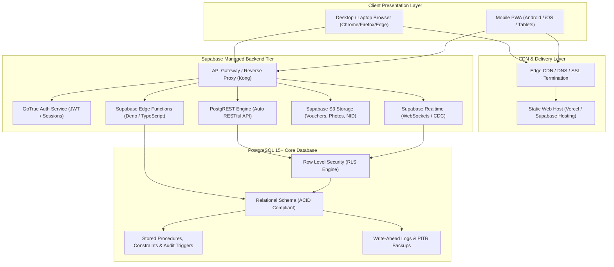
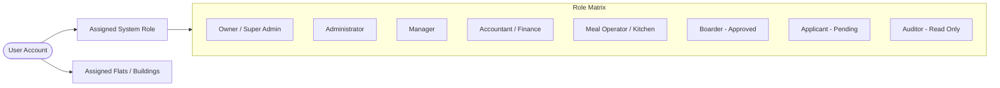
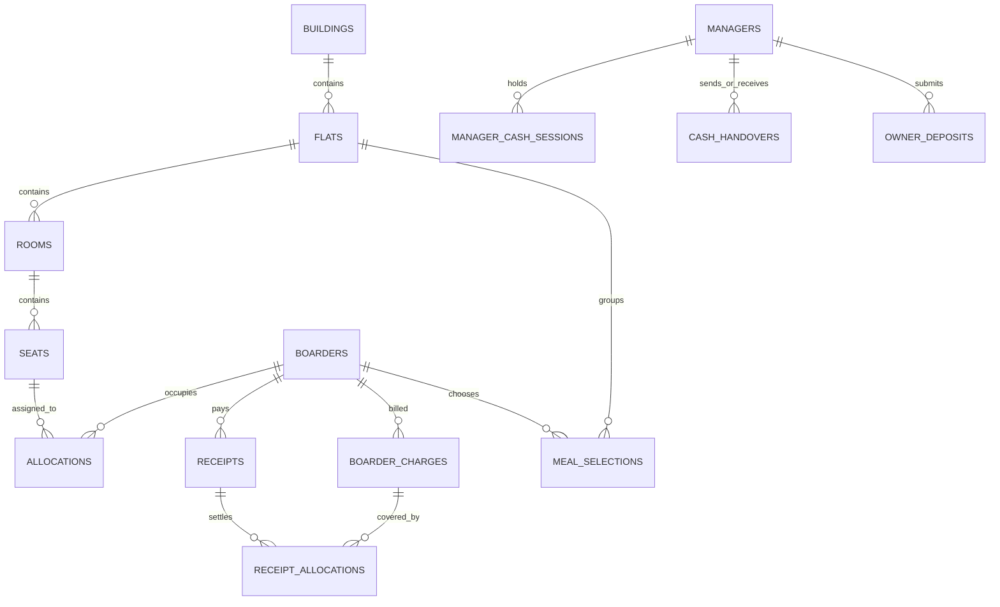
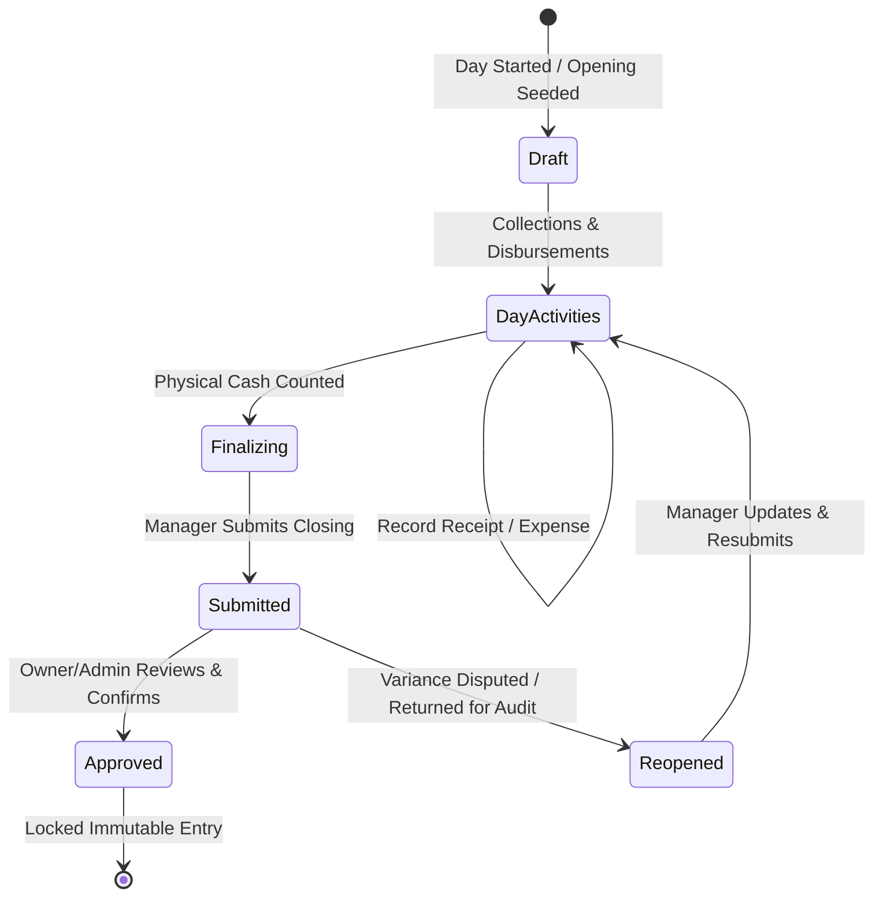
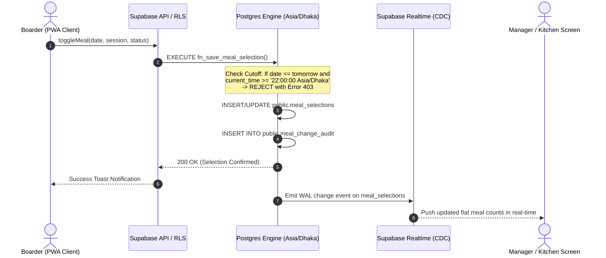
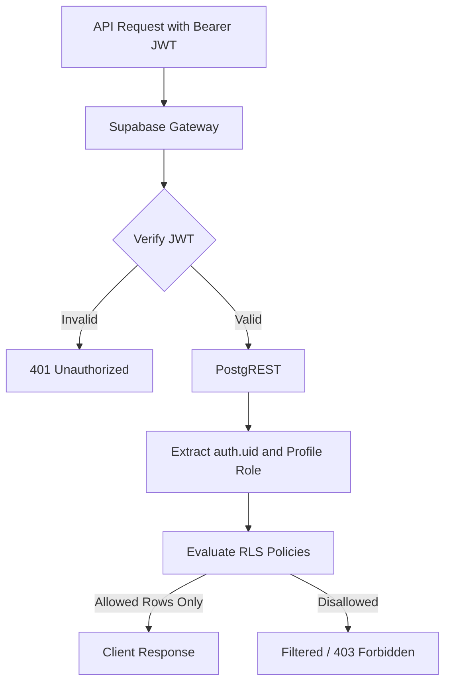
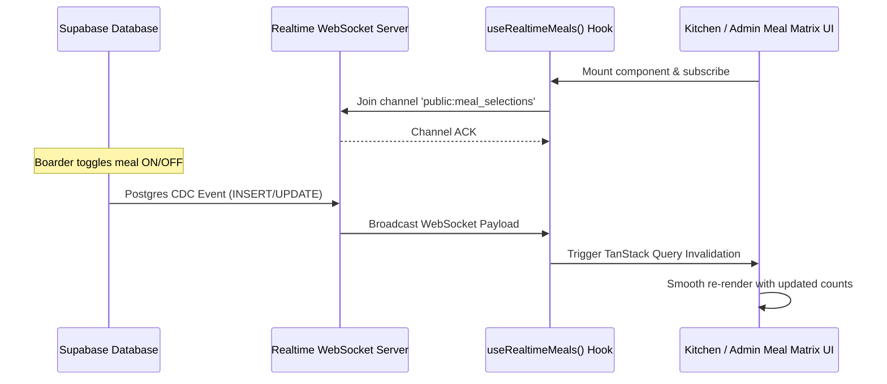
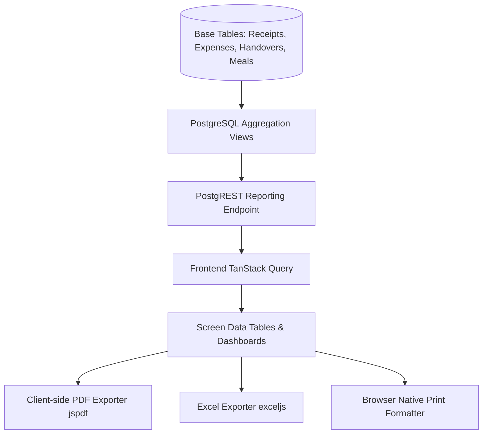
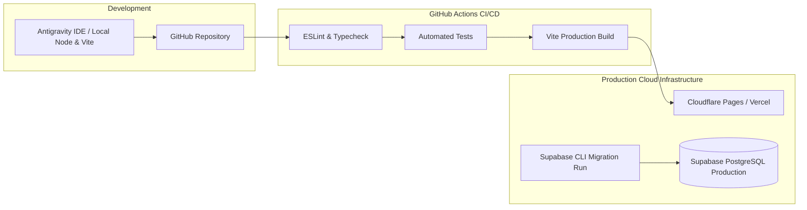

# Bachelor Home ERP — Technical Architecture Document
**Version:** 1.0  
**Status:** Approved Architectural Blueprint  
**Date:** 15 October 2026  
**Derived From:** Product Requirements Document (PRD v3.0)  
**Target Environment:** Web Application & Mobile PWA  
**Backend & Database Platform:** PostgreSQL 15+ & Supabase Managed Platform  

---

## 1. Executive Architecture Summary

Bachelor Home ERP is an enterprise-grade hostel management system architected to centralize accommodation, boarder lifecycle, multi-custodian financial operations, daily cash reconciliations, optional meal planning with real-time sync, and compliance reporting.

### 1.1 Architectural Principles
1. **Database as the Single Source of Truth (SSOT):** All calculations, financial ledgers, allocation conflicts, and meal cut-offs are strictly evaluated and enforced at the database layer (PostgreSQL + RLS + Database Triggers/Functions).
2. **Zero-Trust Client Design:** The client application (React PWA) is treated as inherently untrusted. Role-Based Access Control (RBAC), multi-tenant tenancy within hostel flats, and state validations are guaranteed by Supabase Row-Level Security (RLS) and PostgreSQL `SECURITY DEFINER` functions.
3. **Double-Entry & Immutable Financial Integrity:** Financial transactions (receipts, expenses, transfers, handovers, owner deposits) are immutable. Corrections are performed exclusively through audited reversal or adjustment entries.
4. **Isolated Custodian Cash Flow:** Cash held by managers is tracked through distinct custody sessions where prior-day closing balances strictly seed current-day opening balances.
5. **Deterministic Timezone Control:** All business logic, daily closes, and meal cutoffs are synchronized to `Asia/Dhaka` (UTC+6) at the database engine level.
6. **Mobile-First Progressive Enhancement:** Desktop-first productivity features (keyboard shortcuts, dense data tables) combined with mobile-first PWA ergonomics (offline app shell, fast touch targets, native camera integration for voucher uploads).

---

## 2. High-Level System Architecture



---

## 3. Technology Stack & Specifications

| Layer | Technology | Specification / Rationale |
| :--- | :--- | :--- |
| **Frontend Framework** | React 18+ with TypeScript | Strict type safety, modular component hierarchy, high developer productivity. |
| **Build Tool & Bundler** | Vite 5+ | Instant HMR, optimized tree-shaking, fast production builds. |
| **UI & Styling System** | Tailwind CSS + Radix UI Primitives | Accessible UI components, responsive layout utilities, dark/light theme support. |
| **Icons & Typography** | Lucide React + Google Fonts (Inter & Hind Siliguri) | High-legibility bilingual rendering for English and Bengali scripts. |
| **State Management** | TanStack Query v5 + Zustand | Server-state caching, optimistic updates, and lightweight global client state. |
| **Internationalization (i18n)** | i18next + react-i18next | Seamless runtime switching between English and Bangla (`bn-BD`). |
| **PWA & Offline Shell** | Vite PWA Plugin + Workbox | Web app manifest, service worker caching (Stale-While-Revalidate for app shell). |
| **Backend as a Service** | Supabase Platform | Fully-managed PostgreSQL, GoTrue Auth, Realtime WebSockets, S3 Storage. |
| **Database Engine** | PostgreSQL 15+ | Relational integrity, ACID compliance, `btree_gist` constraint support, JSONB. |
| **Date & Time Engine** | Day.js / date-fns-tz | Standardized to `Asia/Dhaka` with timezone offsets handled uniformly. |
| **Report Export Engines** | `exceljs` / `jspdf` / `jspdf-autotable` | High-fidelity client-side PDF invoices, vouchers, and Excel financial reports. |

---

## 4. User Roles, Granular Permissions & Access Scopes

The system implements a dual-dimension security matrix: **Functional Role** + **Geographic Scope (Assigned Building/Flat)**.



### 4.1 Role Definitions & Permission Matrix

| Role | Scope | Accommodation | Finance & Collections | Cash Custody | Meal Management | Reports & Audit |
| :--- | :--- | :--- | :--- | :--- | :--- | :--- |
| **Owner / Super Admin** | Global (All Buildings/Flats) | Full Access | Full Access | Full Access & Final Approval | Full Access & Overrides | All Master Dashboards & Logs |
| **Administrator** | Global or Assigned Hostels | Full Access | Manage Billing, Expenses, Incomes | View & Review Closings | Manage Rates & Cutoffs | Operational & Financial Reports |
| **Manager** | Assigned Flats Only | View Rooms, Allocate Seats | Collect Receipts, Record Expenses | Mandatory Daily Cash Session | View Flat Meals, Kitchen List | Flat Reports & Own Custody Reports |
| **Accountant / Finance** | Global Financial Scope | View Occupancy Only | Ledger Entries, Void/Reversals | Review Handovers & Deposits | View Meal Billing Ledgers | Complete Financial Reports |
| **Meal Operator / Kitchen** | Global or Assigned Flats | None | None | None | View Daily Meal Counts & Lists | Kitchen Preparation Reports |
| **Boarder (Approved)** | Self (Own Profile Only) | View Own Room/Seat | View Own Ledger & Receipts | None | Toggle Own Future Meals | View Own Meal History |
| **Boarder (Pending)** | Self (Registration Portal) | None | None | None | None | View Own Application Status |
| **Auditor** | Read-Only | Read-Only | Read-Only | Read-Only | Read-Only | System Audit Logs & Reports |

---

## 5. Domain Model & Detailed Database Schema

All primary keys use UUID v4. Monetary values are strictly stored as `NUMERIC(12,2)` to eliminate floating-point inaccuracies. Timestamps are stored as `TIMESTAMPTZ` and evaluated under `Asia/Dhaka`.



### 5.1 Identity, Access & Profiles

#### `public.profiles`
Stores user profile information linked directly to `auth.users`.
```sql
CREATE TABLE public.profiles (
    id UUID PRIMARY KEY REFERENCES auth.users(id) ON DELETE CASCADE,
    email VARCHAR(255) NOT NULL UNIQUE,
    full_name VARCHAR(150) NOT NULL,
    phone_number VARCHAR(20) NOT NULL,
    role VARCHAR(50) NOT NULL CHECK (role IN (
        'SUPER_ADMIN', 'ADMIN', 'MANAGER', 'ACCOUNTANT', 
        'MEAL_OPERATOR', 'BOARDER', 'APPLICANT', 'AUDITOR'
    )),
    is_active BOOLEAN NOT NULL DEFAULT true,
    preferred_language VARCHAR(5) NOT NULL DEFAULT 'bn' CHECK (preferred_language IN ('bn', 'en')),
    avatar_url TEXT,
    created_at TIMESTAMPTZ NOT NULL DEFAULT timezone('Asia/Dhaka', now()),
    updated_at TIMESTAMPTZ NOT NULL DEFAULT timezone('Asia/Dhaka', now())
);
```

#### `public.user_flat_assignments`
Restricts managers and meal operators to specific flats.
```sql
CREATE TABLE public.user_flat_assignments (
    id UUID PRIMARY KEY DEFAULT gen_random_uuid(),
    user_id UUID NOT NULL REFERENCES public.profiles(id) ON DELETE CASCADE,
    flat_id UUID NOT NULL REFERENCES public.flats(id) ON DELETE CASCADE,
    assigned_at TIMESTAMPTZ NOT NULL DEFAULT timezone('Asia/Dhaka', now()),
    assigned_by UUID REFERENCES public.profiles(id),
    UNIQUE (user_id, flat_id)
);
```

---

### 5.2 Property & Accommodation Hierarchy

#### `public.buildings`
```sql
CREATE TABLE public.buildings (
    id UUID PRIMARY KEY DEFAULT gen_random_uuid(),
    building_code VARCHAR(50) NOT NULL UNIQUE,
    name VARCHAR(150) NOT NULL,
    address TEXT NOT NULL,
    status VARCHAR(20) NOT NULL DEFAULT 'ACTIVE' CHECK (status IN ('ACTIVE', 'INACTIVE')),
    description TEXT,
    created_at TIMESTAMPTZ NOT NULL DEFAULT timezone('Asia/Dhaka', now()),
    updated_at TIMESTAMPTZ NOT NULL DEFAULT timezone('Asia/Dhaka', now())
);
```

#### `public.flats`
```sql
CREATE TABLE public.flats (
    id UUID PRIMARY KEY DEFAULT gen_random_uuid(),
    building_id UUID NOT NULL REFERENCES public.buildings(id) ON DELETE RESTRICT,
    flat_code VARCHAR(50) NOT NULL,
    name VARCHAR(100) NOT NULL,
    floor_number INT,
    status VARCHAR(20) NOT NULL DEFAULT 'ACTIVE' CHECK (status IN ('ACTIVE', 'INACTIVE')),
    created_at TIMESTAMPTZ NOT NULL DEFAULT timezone('Asia/Dhaka', now()),
    updated_at TIMESTAMPTZ NOT NULL DEFAULT timezone('Asia/Dhaka', now()),
    UNIQUE(building_id, flat_code)
);
```

#### `public.rooms`
```sql
CREATE TABLE public.rooms (
    id UUID PRIMARY KEY DEFAULT gen_random_uuid(),
    flat_id UUID NOT NULL REFERENCES public.flats(id) ON DELETE RESTRICT,
    room_code VARCHAR(50) NOT NULL,
    name VARCHAR(100) NOT NULL,
    room_type VARCHAR(50) NOT NULL DEFAULT 'STANDARD',
    status VARCHAR(20) NOT NULL DEFAULT 'ACTIVE' CHECK (status IN ('ACTIVE', 'INACTIVE')),
    created_at TIMESTAMPTZ NOT NULL DEFAULT timezone('Asia/Dhaka', now()),
    updated_at TIMESTAMPTZ NOT NULL DEFAULT timezone('Asia/Dhaka', now()),
    UNIQUE(flat_id, room_code)
);
```

#### `public.seats`
```sql
CREATE TABLE public.seats (
    id UUID PRIMARY KEY DEFAULT gen_random_uuid(),
    room_id UUID NOT NULL REFERENCES public.rooms(id) ON DELETE RESTRICT,
    seat_code VARCHAR(50) NOT NULL,
    seat_name VARCHAR(100) NOT NULL,
    default_rent NUMERIC(12,2) NOT NULL CHECK (default_rent >= 0),
    status VARCHAR(20) NOT NULL DEFAULT 'AVAILABLE' CHECK (status IN ('AVAILABLE', 'OCCUPIED', 'MAINTENANCE', 'INACTIVE')),
    created_at TIMESTAMPTZ NOT NULL DEFAULT timezone('Asia/Dhaka', now()),
    updated_at TIMESTAMPTZ NOT NULL DEFAULT timezone('Asia/Dhaka', now()),
    UNIQUE(room_id, seat_code)
);
```

---

### 5.3 Boarder Management & Allocations

#### `public.boarders`
```sql
CREATE TABLE public.boarders (
    id UUID PRIMARY KEY DEFAULT gen_random_uuid(),
    user_id UUID UNIQUE REFERENCES public.profiles(id) ON DELETE SET NULL,
    boarder_code VARCHAR(50) NOT NULL UNIQUE,
    full_name VARCHAR(150) NOT NULL,
    phone_number VARCHAR(20) NOT NULL,
    email VARCHAR(255),
    photo_url TEXT,
    nid_passport_number VARCHAR(50),
    nid_document_url TEXT,
    student_id VARCHAR(50),
    institution VARCHAR(200),
    department VARCHAR(100),
    guardian_name VARCHAR(150) NOT NULL,
    guardian_phone VARCHAR(20) NOT NULL,
    guardian_relation VARCHAR(50),
    present_address TEXT,
    permanent_address TEXT NOT NULL,
    emergency_contact VARCHAR(20),
    admission_date DATE NOT NULL,
    leaving_date DATE,
    status VARCHAR(20) NOT NULL DEFAULT 'PENDING' CHECK (status IN ('PENDING', 'ACTIVE', 'LEFT', 'REJECTED')),
    created_at TIMESTAMPTZ NOT NULL DEFAULT timezone('Asia/Dhaka', now()),
    updated_at TIMESTAMPTZ NOT NULL DEFAULT timezone('Asia/Dhaka', now())
);
```

#### `public.allocations`
Enforces single active allocation per seat using a partial unique index.
```sql
CREATE TABLE public.allocations (
    id UUID PRIMARY KEY DEFAULT gen_random_uuid(),
    boarder_id UUID NOT NULL REFERENCES public.boarders(id) ON DELETE RESTRICT,
    seat_id UUID NOT NULL REFERENCES public.seats(id) ON DELETE RESTRICT,
    monthly_rent NUMERIC(12,2) NOT NULL CHECK (monthly_rent >= 0),
    security_deposit NUMERIC(12,2) NOT NULL DEFAULT 0.00 CHECK (security_deposit >= 0),
    start_date DATE NOT NULL,
    end_date DATE,
    status VARCHAR(20) NOT NULL DEFAULT 'ACTIVE' CHECK (status IN ('ACTIVE', 'ENDED', 'TRANSFERRED', 'CANCELLED')),
    cancellation_reason TEXT,
    created_by UUID REFERENCES public.profiles(id),
    created_at TIMESTAMPTZ NOT NULL DEFAULT timezone('Asia/Dhaka', now()),
    updated_at TIMESTAMPTZ NOT NULL DEFAULT timezone('Asia/Dhaka', now())
);

-- Crucial Constraint: Guarantee no two active allocations for the same seat
CREATE UNIQUE INDEX idx_unique_active_seat_allocation 
ON public.allocations (seat_id) 
WHERE status = 'ACTIVE';
```

---

### 5.4 Billing, Receipts & Accounts

#### `public.financial_accounts`
Represents physical cash, bank accounts, and mobile financial services (bKash/Nagad).
```sql
CREATE TABLE public.financial_accounts (
    id UUID PRIMARY KEY DEFAULT gen_random_uuid(),
    account_name VARCHAR(100) NOT NULL,
    account_type VARCHAR(50) NOT NULL CHECK (account_type IN ('CASH_MANAGER', 'CASH_OWNER', 'BANK', 'MFS')),
    account_number VARCHAR(100),
    bank_name VARCHAR(100),
    current_balance NUMERIC(14,2) NOT NULL DEFAULT 0.00,
    assigned_manager_id UUID REFERENCES public.profiles(id),
    is_active BOOLEAN NOT NULL DEFAULT true,
    created_at TIMESTAMPTZ NOT NULL DEFAULT timezone('Asia/Dhaka', now())
);
```

#### `public.boarder_charges`
Tracks monthly rent, electricity, utilities, and penalty dues.
```sql
CREATE TABLE public.boarder_charges (
    id UUID PRIMARY KEY DEFAULT gen_random_uuid(),
    boarder_id UUID NOT NULL REFERENCES public.boarders(id) ON DELETE RESTRICT,
    allocation_id UUID REFERENCES public.allocations(id) ON DELETE RESTRICT,
    charge_type VARCHAR(50) NOT NULL CHECK (charge_type IN ('RENT', 'UTILITY', 'MEAL', 'PENALTY', 'ADMISSION_FEE', 'OTHER')),
    billing_month DATE NOT NULL, -- e.g., '2026-10-01'
    amount NUMERIC(12,2) NOT NULL CHECK (amount > 0),
    paid_amount NUMERIC(12,2) NOT NULL DEFAULT 0.00 CHECK (paid_amount >= 0),
    due_amount NUMERIC(12,2) GENERATED ALWAYS AS (amount - paid_amount) STORED,
    status VARCHAR(20) NOT NULL DEFAULT 'UNPAID' CHECK (status IN ('UNPAID', 'PARTIALLY_PAID', 'PAID', 'VOID')),
    due_date DATE NOT NULL,
    created_at TIMESTAMPTZ NOT NULL DEFAULT timezone('Asia/Dhaka', now())
);
```

#### `public.receipts`
```sql
CREATE TABLE public.receipts (
    id UUID PRIMARY KEY DEFAULT gen_random_uuid(),
    receipt_number VARCHAR(50) NOT NULL UNIQUE,
    boarder_id UUID NOT NULL REFERENCES public.boarders(id) ON DELETE RESTRICT,
    received_by UUID NOT NULL REFERENCES public.profiles(id), -- Manager/Collector
    destination_account_id UUID NOT NULL REFERENCES public.financial_accounts(id),
    amount NUMERIC(12,2) NOT NULL CHECK (amount > 0),
    payment_method VARCHAR(30) NOT NULL CHECK (payment_method IN ('CASH', 'BANK_TRANSFER', 'MFS')),
    transaction_reference VARCHAR(100),
    receipt_date TIMESTAMPTZ NOT NULL DEFAULT timezone('Asia/Dhaka', now()),
    is_void BOOLEAN NOT NULL DEFAULT false,
    void_reason TEXT,
    void_by UUID REFERENCES public.profiles(id),
    void_at TIMESTAMPTZ,
    created_at TIMESTAMPTZ NOT NULL DEFAULT timezone('Asia/Dhaka', now())
);
```

#### `public.receipt_allocations`
Maps payments directly to specific charges (supporting partial payments).
```sql
CREATE TABLE public.receipt_allocations (
    id UUID PRIMARY KEY DEFAULT gen_random_uuid(),
    receipt_id UUID NOT NULL REFERENCES public.receipts(id) ON DELETE CASCADE,
    charge_id UUID NOT NULL REFERENCES public.boarder_charges(id) ON DELETE RESTRICT,
    allocated_amount NUMERIC(12,2) NOT NULL CHECK (allocated_amount > 0),
    created_at TIMESTAMPTZ NOT NULL DEFAULT timezone('Asia/Dhaka', now())
);
```

#### `public.expenses`
```sql
CREATE TABLE public.expenses (
    id UUID PRIMARY KEY DEFAULT gen_random_uuid(),
    expense_voucher_no VARCHAR(50) NOT NULL UNIQUE,
    category VARCHAR(100) NOT NULL,
    amount NUMERIC(12,2) NOT NULL CHECK (amount > 0),
    source_account_id UUID NOT NULL REFERENCES public.financial_accounts(id),
    flat_id UUID REFERENCES public.flats(id), -- Optional flat-wise allocation
    building_id UUID REFERENCES public.buildings(id),
    expense_date DATE NOT NULL,
    description TEXT NOT NULL,
    voucher_attachment_url TEXT,
    paid_by UUID NOT NULL REFERENCES public.profiles(id), -- Manager who disbursed
    approval_status VARCHAR(20) NOT NULL DEFAULT 'PENDING' CHECK (approval_status IN ('PENDING', 'APPROVED', 'REJECTED')),
    approved_by UUID REFERENCES public.profiles(id),
    created_at TIMESTAMPTZ NOT NULL DEFAULT timezone('Asia/Dhaka', now())
);
```

---

### 5.5 Manager Cash Custody & Daily Reconciliation Engine

This subsystem guarantees financial control over cash in transit.



#### `public.manager_cash_sessions`
```sql
CREATE TABLE public.manager_cash_sessions (
    id UUID PRIMARY KEY DEFAULT gen_random_uuid(),
    manager_id UUID NOT NULL REFERENCES public.profiles(id),
    account_id UUID NOT NULL REFERENCES public.financial_accounts(id),
    session_date DATE NOT NULL,
    opening_cash NUMERIC(12,2) NOT NULL CHECK (opening_cash >= 0),
    cash_receipts NUMERIC(12,2) NOT NULL DEFAULT 0.00,
    cash_expenses NUMERIC(12,2) NOT NULL DEFAULT 0.00,
    cash_deposited_to_owner NUMERIC(12,2) NOT NULL DEFAULT 0.00,
    cash_handed_over_out NUMERIC(12,2) NOT NULL DEFAULT 0.00,
    cash_handed_over_in NUMERIC(12,2) NOT NULL DEFAULT 0.00,
    expected_closing_cash NUMERIC(12,2) GENERATED ALWAYS AS (
        opening_cash + cash_receipts + cash_handed_over_in - cash_expenses - cash_deposited_to_owner - cash_handed_over_out
    ) STORED,
    actual_counted_cash NUMERIC(12,2),
    cash_variance NUMERIC(12,2) GENERATED ALWAYS AS (
        actual_counted_cash - (opening_cash + cash_receipts + cash_handed_over_in - cash_expenses - cash_deposited_to_owner - cash_handed_over_out)
    ) STORED,
    variance_explanation TEXT,
    status VARCHAR(20) NOT NULL DEFAULT 'OPEN' CHECK (status IN ('OPEN', 'SUBMITTED', 'APPROVED', 'REOPENED')),
    submitted_at TIMESTAMPTZ,
    reviewed_by UUID REFERENCES public.profiles(id),
    reviewed_at TIMESTAMPTZ,
    created_at TIMESTAMPTZ NOT NULL DEFAULT timezone('Asia/Dhaka', now()),
    updated_at TIMESTAMPTZ NOT NULL DEFAULT timezone('Asia/Dhaka', now()),
    UNIQUE(manager_id, session_date)
);
```

#### `public.owner_deposits`
Deposits from manager custody to the owner.
```sql
CREATE TABLE public.owner_deposits (
    id UUID PRIMARY KEY DEFAULT gen_random_uuid(),
    deposit_number VARCHAR(50) NOT NULL UNIQUE,
    manager_id UUID NOT NULL REFERENCES public.profiles(id),
    from_account_id UUID NOT NULL REFERENCES public.financial_accounts(id),
    to_account_id UUID NOT NULL REFERENCES public.financial_accounts(id), -- Owner Cash/Bank
    amount NUMERIC(12,2) NOT NULL CHECK (amount > 0),
    payment_method VARCHAR(30) NOT NULL,
    proof_attachment_url TEXT,
    status VARCHAR(20) NOT NULL DEFAULT 'PENDING' CHECK (status IN ('PENDING', 'CONFIRMED', 'REJECTED')),
    confirmed_by UUID REFERENCES public.profiles(id),
    confirmed_at TIMESTAMPTZ,
    created_at TIMESTAMPTZ NOT NULL DEFAULT timezone('Asia/Dhaka', now())
);
```

#### `public.cash_handovers`
Transfers between two managers/custodians. Both must confirm.
```sql
CREATE TABLE public.cash_handovers (
    id UUID PRIMARY KEY DEFAULT gen_random_uuid(),
    handover_number VARCHAR(50) NOT NULL UNIQUE,
    sender_manager_id UUID NOT NULL REFERENCES public.profiles(id),
    receiver_manager_id UUID NOT NULL REFERENCES public.profiles(id),
    amount NUMERIC(12,2) NOT NULL CHECK (amount > 0),
    handover_reason TEXT NOT NULL,
    status VARCHAR(20) NOT NULL DEFAULT 'PENDING' CHECK (status IN ('PENDING', 'ACCEPTED', 'REJECTED', 'CANCELLED')),
    accepted_at TIMESTAMPTZ,
    created_at TIMESTAMPTZ NOT NULL DEFAULT timezone('Asia/Dhaka', now())
);
```

---

### 5.6 Meal Engine & Strict Cutoff Architecture



#### `public.meal_settings`
```sql
CREATE TABLE public.meal_settings (
    id UUID PRIMARY KEY DEFAULT gen_random_uuid(),
    is_meal_module_enabled BOOLEAN NOT NULL DEFAULT true,
    breakfast_enabled BOOLEAN NOT NULL DEFAULT true,
    lunch_enabled BOOLEAN NOT NULL DEFAULT true,
    dinner_enabled BOOLEAN NOT NULL DEFAULT true,
    cutoff_time TIME NOT NULL DEFAULT '22:00:00', -- 10:00 PM Asia/Dhaka
    updated_by UUID REFERENCES public.profiles(id),
    updated_at TIMESTAMPTZ NOT NULL DEFAULT timezone('Asia/Dhaka', now())
);
```

#### `public.meal_rates`
```sql
CREATE TABLE public.meal_rates (
    id UUID PRIMARY KEY DEFAULT gen_random_uuid(),
    effective_from DATE NOT NULL,
    effective_to DATE,
    breakfast_rate NUMERIC(8,2) NOT NULL DEFAULT 0.00,
    lunch_rate NUMERIC(8,2) NOT NULL DEFAULT 0.00,
    dinner_rate NUMERIC(8,2) NOT NULL DEFAULT 0.00,
    created_at TIMESTAMPTZ NOT NULL DEFAULT timezone('Asia/Dhaka', now())
);
```

#### `public.meal_selections`
```sql
CREATE TABLE public.meal_selections (
    id UUID PRIMARY KEY DEFAULT gen_random_uuid(),
    boarder_id UUID NOT NULL REFERENCES public.boarders(id) ON DELETE CASCADE,
    flat_id UUID NOT NULL REFERENCES public.flats(id) ON DELETE RESTRICT,
    meal_date DATE NOT NULL,
    breakfast BOOLEAN NOT NULL DEFAULT false,
    lunch BOOLEAN NOT NULL DEFAULT false,
    dinner BOOLEAN NOT NULL DEFAULT false,
    is_locked BOOLEAN NOT NULL DEFAULT false,
    is_override BOOLEAN NOT NULL DEFAULT false,
    override_reason TEXT,
    override_by UUID REFERENCES public.profiles(id),
    created_at TIMESTAMPTZ NOT NULL DEFAULT timezone('Asia/Dhaka', now()),
    updated_at TIMESTAMPTZ NOT NULL DEFAULT timezone('Asia/Dhaka', now()),
    UNIQUE(boarder_id, meal_date)
);
```

#### `public.meal_change_audit`
```sql
CREATE TABLE public.meal_change_audit (
    id UUID PRIMARY KEY DEFAULT gen_random_uuid(),
    selection_id UUID NOT NULL REFERENCES public.meal_selections(id) ON DELETE CASCADE,
    boarder_id UUID NOT NULL REFERENCES public.boarders(id),
    meal_date DATE NOT NULL,
    session_changed VARCHAR(20) NOT NULL CHECK (session_changed IN ('BREAKFAST', 'LUNCH', 'DINNER')),
    old_value BOOLEAN NOT NULL,
    new_value BOOLEAN NOT NULL,
    changed_by UUID NOT NULL REFERENCES public.profiles(id),
    changed_at TIMESTAMPTZ NOT NULL DEFAULT timezone('Asia/Dhaka', now())
);
```

---

### 5.7 Audit Trails & System Logs

#### `public.audit_logs`
Immutable log for tracking sensitive administrative, accommodation, and financial actions.
```sql
CREATE TABLE public.audit_logs (
    id UUID PRIMARY KEY DEFAULT gen_random_uuid(),
    table_name VARCHAR(100) NOT NULL,
    record_id UUID NOT NULL,
    action VARCHAR(20) NOT NULL CHECK (action IN ('INSERT', 'UPDATE', 'DELETE', 'VOID', 'OVERRIDE')),
    old_data JSONB,
    new_data JSONB,
    actor_id UUID REFERENCES public.profiles(id),
    ip_address VARCHAR(50),
    user_agent TEXT,
    created_at TIMESTAMPTZ NOT NULL DEFAULT timezone('Asia/Dhaka', now())
);

-- RLS: Nobody may update or delete audit logs
ALTER TABLE public.audit_logs ENABLE ROW LEVEL SECURITY;
CREATE POLICY audit_logs_readonly_policy ON public.audit_logs FOR SELECT USING (
    auth.jwt() ->> 'role' IN ('SUPER_ADMIN', 'AUDITOR')
);
```

---

## 6. Security Architecture & Row-Level Security (RLS)

Every table in the database has RLS enabled by default. Frontend requests interact exclusively through PostgreSQL session credentials derived from the authenticated JWT.



### 6.1 Critical Row Level Security Policies

#### 1. Accommodation Access by Flat Assignment
Managers can only query accommodations for assigned flats; Super Admins have global access.
```sql
ALTER TABLE public.flats ENABLE ROW LEVEL SECURITY;

CREATE POLICY flat_access_policy ON public.flats
FOR SELECT TO authenticated
USING (
    EXISTS (
        SELECT 1 FROM public.profiles p 
        WHERE p.id = auth.uid() AND p.role IN ('SUPER_ADMIN', 'ADMIN', 'ACCOUNTANT', 'AUDITOR')
    ) OR EXISTS (
        SELECT 1 FROM public.user_flat_assignments ufa 
        WHERE ufa.user_id = auth.uid() AND ufa.flat_id = public.flats.id
    )
);
```

#### 2. Boarder Portal Strict Isolation
Unapproved applicants can only read/edit their own pending registration; active boarders see only their own data.
```sql
ALTER TABLE public.boarders ENABLE ROW LEVEL SECURITY;

CREATE POLICY boarder_self_read_policy ON public.boarders
FOR SELECT TO authenticated
USING (
    user_id = auth.uid()
    OR EXISTS (
        SELECT 1 FROM public.profiles p 
        WHERE p.id = auth.uid() AND p.role IN ('SUPER_ADMIN', 'ADMIN', 'MANAGER', 'ACCOUNTANT', 'AUDITOR')
    )
);

CREATE POLICY applicant_insert_policy ON public.boarders
FOR INSERT TO authenticated
WITH CHECK (
    user_id = auth.uid() AND status = 'PENDING'
);
```

#### 3. Meal Selection Self-Service & Cutoff Policy
Boarders can read and write only their own meals. Updates are barred after 10:00 PM Asia/Dhaka for the next day.
```sql
ALTER TABLE public.meal_selections ENABLE ROW LEVEL SECURITY;

CREATE POLICY meal_boarder_select_policy ON public.meal_selections
FOR SELECT TO authenticated
USING (
    boarder_id IN (SELECT b.id FROM public.boarders b WHERE b.user_id = auth.uid())
    OR EXISTS (
        SELECT 1 FROM public.profiles p 
        WHERE p.id = auth.uid() AND p.role IN ('SUPER_ADMIN', 'ADMIN', 'MEAL_OPERATOR')
    )
    OR EXISTS (
        SELECT 1 FROM public.user_flat_assignments ufa 
        WHERE ufa.user_id = auth.uid() AND ufa.flat_id = public.meal_selections.flat_id
    )
);
```

---

## 7. Core Business Logic & Database Functions (RPC)

Critical multi-step operations execute inside atomic PostgreSQL transactions via `SECURITY DEFINER` functions.

### 7.1 Meal Toggle with Server-Enforced 10 PM Cutoff
```sql
CREATE OR REPLACE FUNCTION public.fn_toggle_meal_selection(
    p_meal_date DATE,
    p_session VARCHAR(20),
    p_new_state BOOLEAN,
    p_override_reason TEXT DEFAULT NULL
)
RETURNS JSONB
LANGUAGE plpgsql
SECURITY DEFINER
SET search_path = public, pg_temp
AS $$
DECLARE
    v_user_id UUID := auth.uid();
    v_user_role VARCHAR(50);
    v_boarder_id UUID;
    v_flat_id UUID;
    v_current_dhaka_time TIME := (timezone('Asia/Dhaka', now()))::TIME;
    v_current_dhaka_date DATE := (timezone('Asia/Dhaka', now()))::DATE;
    v_is_override BOOLEAN := false;
BEGIN
    SELECT role INTO v_user_role FROM public.profiles WHERE id = v_user_id;

    -- Retrieve boarder ID and flat ID
    SELECT b.id, a.seat_id, r.flat_id 
    INTO v_boarder_id, v_flat_id
    FROM public.boarders b
    JOIN public.allocations a ON a.boarder_id = b.id AND a.status = 'ACTIVE'
    JOIN public.seats s ON s.id = a.seat_id
    JOIN public.rooms r ON r.id = s.room_id
    WHERE b.user_id = v_user_id;

    IF v_boarder_id IS NULL THEN
        RAISE EXCEPTION 'Active boarder allocation not found for authenticated user.';
    END IF;

    -- Validate Cutoff: If editing tomorrow's meal, must be before 10:00 PM (22:00:00)
    IF p_meal_date = (v_current_dhaka_date + INTERVAL '1 day')::DATE THEN
        IF v_current_dhaka_time >= '22:00:00'::TIME THEN
            IF v_user_role IN ('SUPER_ADMIN', 'ADMIN') THEN
                v_is_override := true;
            ELSE
                RAISE EXCEPTION '10:00 PM cutoff reached. Next-day meal changes are locked.';
            END IF;
        END IF;
    ELSIF p_meal_date <= v_current_dhaka_date THEN
        IF v_user_role NOT IN ('SUPER_ADMIN', 'ADMIN') THEN
            RAISE EXCEPTION 'Past or same-day meal edits are strictly locked.';
        ELSE
            v_is_override := true;
        END IF;
    END IF;

    -- Upsert meal selection
    INSERT INTO public.meal_selections (
        boarder_id, flat_id, meal_date, breakfast, lunch, dinner, is_override, override_reason, override_by
    )
    VALUES (
        v_boarder_id, v_flat_id, p_meal_date,
        CASE WHEN p_session = 'BREAKFAST' THEN p_new_state ELSE false END,
        CASE WHEN p_session = 'LUNCH' THEN p_new_state ELSE false END,
        CASE WHEN p_session = 'DINNER' THEN p_new_state ELSE false END,
        v_is_override, p_override_reason, CASE WHEN v_is_override THEN v_user_id ELSE NULL END
    )
    ON CONFLICT (boarder_id, meal_date) DO UPDATE SET
        breakfast = CASE WHEN p_session = 'BREAKFAST' THEN p_new_state ELSE meal_selections.breakfast END,
        lunch = CASE WHEN p_session = 'LUNCH' THEN p_new_state ELSE meal_selections.lunch END,
        dinner = CASE WHEN p_session = 'DINNER' THEN p_new_state ELSE meal_selections.dinner END,
        is_override = CASE WHEN v_is_override THEN true ELSE meal_selections.is_override END,
        override_reason = COALESCE(p_override_reason, meal_selections.override_reason),
        override_by = CASE WHEN v_is_override THEN v_user_id ELSE meal_selections.override_by END,
        updated_at = timezone('Asia/Dhaka', now());

    RETURN jsonb_build_object('success', true, 'message', 'Meal preference updated successfully.');
END;
$$;
```

---

### 7.2 Atomic Receipt Recording with Dues Settlement
```sql
CREATE OR REPLACE FUNCTION public.fn_record_receipt(
    p_boarder_id UUID,
    p_amount NUMERIC(12,2),
    p_payment_method VARCHAR(30),
    p_destination_account_id UUID,
    p_reference VARCHAR(100),
    p_allocations JSONB -- Array of {charge_id: UUID, amount: NUMERIC}
)
RETURNS JSONB
LANGUAGE plpgsql
SECURITY DEFINER
AS $$
DECLARE
    v_collector_id UUID := auth.uid();
    v_receipt_id UUID;
    v_receipt_no VARCHAR(50);
    v_item RECORD;
    v_total_allocated NUMERIC(12,2) := 0;
BEGIN
    -- Generate sequential receipt number (e.g., REC-202610-0012)
    v_receipt_no := 'REC-' || to_char(now(), 'YYYYMM') || '-' || lpad(nextval('receipt_seq')::text, 4, '0');

    -- Create Receipt Record
    INSERT INTO public.receipts (
        receipt_number, boarder_id, received_by, destination_account_id,
        amount, payment_method, transaction_reference
    )
    VALUES (
        v_receipt_no, p_boarder_id, v_collector_id, p_destination_account_id,
        p_amount, p_payment_method, p_reference
    )
    RETURNING id INTO v_receipt_id;

    -- Allocate payment across specified charges
    FOR v_item IN SELECT * FROM jsonb_to_recordset(p_allocations) AS (charge_id UUID, amount NUMERIC)
    LOOP
        INSERT INTO public.receipt_allocations (receipt_id, charge_id, allocated_amount)
        VALUES (v_receipt_id, v_item.charge_id, v_item.amount);

        -- Update Boarder Charge Status
        UPDATE public.boarder_charges
        SET paid_amount = paid_amount + v_item.amount,
            status = CASE 
                WHEN (paid_amount + v_item.amount) >= amount THEN 'PAID'
                ELSE 'PARTIALLY_PAID'
            END
        WHERE id = v_item.charge_id;

        v_total_allocated := v_total_allocated + v_item.amount;
    END LOOP;

    -- Update destination financial account balance
    UPDATE public.financial_accounts
    SET current_balance = current_balance + p_amount
    WHERE id = p_destination_account_id;

    -- Update manager's cash session if deposited to a CASH_MANAGER account
    UPDATE public.manager_cash_sessions
    SET cash_receipts = cash_receipts + p_amount
    WHERE manager_id = v_collector_id AND session_date = (timezone('Asia/Dhaka', now()))::DATE;

    RETURN jsonb_build_object('success', true, 'receipt_number', v_receipt_no, 'receipt_id', v_receipt_id);
END;
$$;
```

---

### 7.3 Manager Daily Cash Closing & Opening Balance Carryover
```sql
CREATE OR REPLACE FUNCTION public.fn_submit_daily_cash_close(
    p_session_id UUID,
    p_actual_counted_cash NUMERIC(12,2),
    p_variance_explanation TEXT
)
RETURNS JSONB
LANGUAGE plpgsql
SECURITY DEFINER
AS $$
DECLARE
    v_session RECORD;
    v_expected NUMERIC(12,2);
    v_variance NUMERIC(12,2);
BEGIN
    SELECT * INTO v_session FROM public.manager_cash_sessions WHERE id = p_session_id;

    IF v_session IS NULL THEN
        RAISE EXCEPTION 'Cash session not found.';
    END IF;

    IF v_session.status = 'APPROVED' THEN
        RAISE EXCEPTION 'Finalized session cannot be modified.';
    END IF;

    v_expected := v_session.opening_cash + v_session.cash_receipts + v_session.cash_handed_over_in 
                  - v_session.cash_expenses - v_session.cash_deposited_to_owner - v_session.cash_handed_over_out;
    v_variance := p_actual_counted_cash - v_expected;

    IF v_variance != 0 AND (p_variance_explanation IS NULL OR trim(p_variance_explanation) = '') THEN
        RAISE EXCEPTION 'A non-zero variance requires a documented explanation.';
    END IF;

    UPDATE public.manager_cash_sessions
    SET actual_counted_cash = p_actual_counted_cash,
        variance_explanation = p_variance_explanation,
        status = 'SUBMITTED',
        submitted_at = timezone('Asia/Dhaka', now()),
        updated_at = timezone('Asia/Dhaka', now())
    WHERE id = p_session_id;

    RETURN jsonb_build_object('success', true, 'variance', v_variance, 'status', 'SUBMITTED');
END;
$$;
```

---

## 8. Frontend Architecture & Progressive Web App (PWA)

### 8.1 Modular Directory Structure
```
frontend/
├── public/
│   ├── favicon.ico
│   ├── manifest.json
│   ├── icons/
│   │   ├── icon-192x192.png
│   │   └── icon-512x512.png
├── src/
│   ├── app/
│   │   ├── router.tsx              # React Router v6 Data API with RLS guards
│   │   ├── store.ts               # Zustand global UI state
│   │   └── queryClient.ts         # TanStack Query client & cache policies
│   ├── assets/
│   ├── components/
│   │   ├── common/                # Buttons, Modals, DataTables, Badges
│   │   ├── layout/                # Sidebar, Header, MobileNav, LanguageToggle
│   │   └── feedback/              # Toast, Skeleton Loaders, ErrorBoundary
│   ├── features/
│   │   ├── auth/                  # Login, Password Reset, Registration Portal
│   │   ├── accommodation/         # Buildings, Flats, Rooms, Seat Allocation
│   │   ├── boarders/              # Profile, Documents, Verification
│   │   ├── billing/               # Invoicing, Receipts, Void Modal
│   │   ├── cash-custody/          # Daily Closing, Handovers, Owner Deposits
│   │   ├── meals/                 # Boarder Toggle Grid, Flat Meal Summary
│   │   └── reports/               # 16 Financial Reports, PDF/Excel Exports
│   ├── hooks/
│   │   ├── useAuth.ts
│   │   ├── useRealtimeMeals.ts    # Supabase Realtime subscription hook
│   │   └── useLanguage.ts         # Bilingual state helper
│   ├── i18n/
│   │   ├── en.json                # English translation dictionary
│   │   ├── bn.json                # Bangla translation dictionary
│   │   └── index.ts
│   ├── lib/
│   │   ├── supabaseClient.ts      # Supabase client singleton
│   │   └── utils.ts               # Currency (BDT), Date (Asia/Dhaka) formatters
│   ├── types/                     # Database generated types & domain models
│   ├── App.tsx
│   └── main.tsx
├── vite.config.ts
└── tailwind.config.js
```

### 8.2 Real-time Meal Synchronization Architecture


### 8.3 PWA Service Worker & Caching Strategy
- **Static Assets (CSS, JS, Fonts):** Cache-First strategy with stale-while-revalidate fallback via Workbox.
- **API & Data Requests (PostgREST):** Network-First strategy with timeout; fallback to cached responses for view-only offline resiliency.
- **Meal & Transaction Writes:** Direct network execution only. If network is lost, transactions fail gracefully with immediate Bengali/English offline error alerts to prevent out-of-sync cash or meal entries.

---

## 9. Reports & Analytics Engine Architecture

The ERP includes a high-performance reporting engine that accesses database views directly without duplicating calculations.



### 9.1 Report Suite Summary

| Report Category | Specific Report | Data Granularity & Filters |
| :--- | :--- | :--- |
| **Owner Dashboard** | Executive KPI Overview | Real-time Occupancy %, Cash in Custody, Dues Aging, Daily Net Profit. |
| **Daily Financials** | Daily Income & Expense | Categorized receipts, operational expenses, net daily balance. |
| **Cash Custody** | Daily Closing & Reconciliation | Opening cash, receipts, expenses, deposits to owner, handovers, counted cash, variance. |
| **Accountability** | Manager Performance Report | Collections, timely closings, variance occurrences, handover compliance. |
| **Accommodation** | Inventory & Vacancy Duration | Available seats, occupancy rate, calculated lost rent on vacant seats. |
| **Meal Operations** | Daily Kitchen Preparation List | Date-wise, Flat-wise Breakfast, Lunch, and Dinner counts for cook dispatch. |
| **Audit & Governance** | System Audit Log | Filterable by actor, date range, table name, and action type (Insert/Update/Void). |

---

## 10. Infrastructure, Deployment & Backup Architecture



### 10.1 Backup, Recovery & Disaster Plan
1. **Automated Database Snapshots:** Daily automated backups maintained across Supabase's multi-AZ managed infrastructure.
2. **Point-In-Time-Recovery (PITR):** Write-Ahead Logging (WAL) enabled, allowing restoration to any specific second within a 7-day rolling window.
3. **Storage Replication:** Boarder identity documents and expense voucher images are stored in redundant private S3-compatible buckets.
4. **Health Check Monitoring:** Background monitoring edge functions run hourly to verify database response latency and log backup completion status.

---

## 11. Traceability Matrix: PRD v3.0 to Architecture

| PRD Section | Architectural Coverage | Primary Component / Module |
| :--- | :--- | :--- |
| **§ 4: Users & Roles** | Role-Based Access Control (RBAC) & Flat Assignments | `public.profiles`, `public.user_flat_assignments`, RLS Engine |
| **§ 5: Boarder Portal** | Pre-approval isolation & restricted self-service | RLS policies on `boarders`, `boarder_applications` |
| **§ 6.2: Hierarchy** | Buildings → Flats → Rooms → Seats | Normalized relational schema with active status flags |
| **§ 6.4: Allocations** | Single active allocation constraint per seat | `idx_unique_active_seat_allocation` Partial Unique Index |
| **§ 6.5: Billing** | Dues calculation, atomic receipts & allocations | `boarder_charges`, `receipts`, `fn_record_receipt` |
| **§ 6.6: Expenses** | Category management & flat-wise expenses | `expenses`, `financial_accounts` |
| **§ 6.7: Cash Custody** | Prior-day carryover, variance computation & locking | `manager_cash_sessions`, `fn_submit_daily_cash_close` |
| **§ 6.8: Meals** | 10 PM Asia/Dhaka cutoff & Realtime sync | `fn_toggle_meal_selection`, Supabase Realtime CDC |
| **§ 7: Reports** | 16 Financial & Operational Reports | Database aggregation views, `exceljs`, `jspdf` |
| **§ 8: UX & Localization** | Responsive desktop & installable mobile PWA | React 18, Tailwind, i18next (Bangla & English), Workbox |
| **§ 11: Security & Audit** | Immutable audit trails, RLS, zero frontend secrets | `public.audit_logs`, RLS policies, GoTrue Auth |

---

## 12. Verification & Next Steps

This architectural design serves as the definitive engineering foundation for the implementation phases:
1. **Phase 1:** Apply database schema, constraints, indexes, and RLS policies via Supabase migrations.
2. **Phase 2:** Build frontend UI shell, bilingual theme system, and Supabase Auth integration.
3. **Phase 3:** Implement accommodation hierarchy, boarder portal, and seat allocation flows.
4. **Phase 4:** Develop financial billing, manager cash custody sessions, and atomic receipt workflows.
5. **Phase 5:** Build meal self-service toggles, server-enforced cutoff, and real-time kitchen monitors.
6. **Phase 6:** Integrate the 16 mandatory reports, testing, and production deployment.
