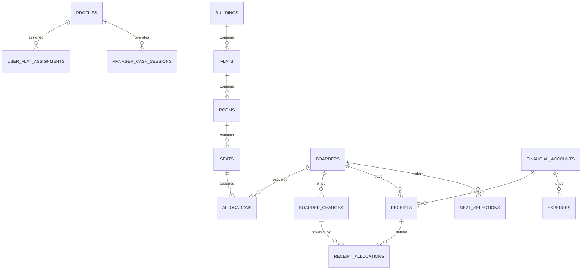

# Bachelor Home ERP — Database Schema Specification
**Version:** 1.0  
**Target Engine:** PostgreSQL 15+ (Supabase Managed Platform)  
**Standard Timezone:** `Asia/Dhaka` (UTC+6)  
**Currency Standard:** Bangladeshi Taka (BDT, `NUMERIC(12,2)`)  
**Derived From:** PRD v3.0 & Technical Architecture Document  

---

## 1. Overview & Conventions

### 1.1 Architectural Standards
- **Primary Keys:** Every primary table uses UUID v4 generated via `gen_random_uuid()`.
- **Foreign Keys:** Explicit referential actions (`ON DELETE RESTRICT` for financial and allocation integrity, `ON DELETE CASCADE` only for dependent join/detail tables).
- **Monetary Precision:** All currency amounts use `NUMERIC(12,2)` or `NUMERIC(14,2)` for account balances. Floating point types (`REAL`, `FLOAT`, `DOUBLE PRECISION`) are strictly forbidden.
- **Timestamps:** All temporal columns use `TIMESTAMPTZ` with `DEFAULT timezone('Asia/Dhaka', now())`.
- **Soft Deletion & Status Flags:** Destructive deletions on financial, occupancy, or audit tables are forbidden. Inactive states are managed via `status` enums or `is_active` flags.
- **Naming Conventions:** All tables and columns are lower snake_case (`meal_selections`, `boarder_charges`).

### 1.2 PostgreSQL Extensions
```sql
CREATE EXTENSION IF NOT EXISTS "uuid-ossp";
CREATE EXTENSION IF NOT EXISTS "pgcrypto";
CREATE EXTENSION IF NOT EXISTS "btree_gist";
CREATE EXTENSION IF NOT EXISTS "pg_trgm";
```

---

## 2. Custom Enums & Types

```sql
-- Identity & Access
CREATE TYPE user_role AS ENUM (
    'SUPER_ADMIN', 
    'ADMIN', 
    'MANAGER', 
    'ACCOUNTANT', 
    'MEAL_OPERATOR', 
    'BOARDER', 
    'APPLICANT', 
    'AUDITOR'
);

-- Accommodation Entities
CREATE TYPE building_status AS ENUM ('ACTIVE', 'INACTIVE');
CREATE TYPE flat_status AS ENUM ('ACTIVE', 'INACTIVE');
CREATE TYPE room_status AS ENUM ('ACTIVE', 'MAINTENANCE', 'INACTIVE');
CREATE TYPE seat_status AS ENUM ('AVAILABLE', 'OCCUPIED', 'MAINTENANCE', 'INACTIVE');

-- Boarder Lifecycle
CREATE TYPE boarder_status AS ENUM ('PENDING', 'ACTIVE', 'LEFT', 'REJECTED');
CREATE TYPE allocation_status AS ENUM ('ACTIVE', 'ENDED', 'TRANSFERRED', 'CANCELLED');

-- Financial
CREATE TYPE financial_account_type AS ENUM ('CASH_MANAGER', 'CASH_OWNER', 'BANK', 'MFS');
CREATE TYPE charge_type AS ENUM ('RENT', 'UTILITY', 'MEAL', 'PENALTY', 'ADMISSION_FEE', 'OTHER');
CREATE TYPE charge_status AS ENUM ('UNPAID', 'PARTIALLY_PAID', 'PAID', 'VOID');
CREATE TYPE payment_method AS ENUM ('CASH', 'BANK_TRANSFER', 'MFS');
CREATE TYPE approval_status AS ENUM ('PENDING', 'APPROVED', 'REJECTED');
CREATE TYPE cash_session_status AS ENUM ('OPEN', 'SUBMITTED', 'APPROVED', 'REOPENED');
CREATE TYPE handover_status AS ENUM ('PENDING', 'ACCEPTED', 'REJECTED', 'CANCELLED');
CREATE TYPE deposit_status AS ENUM ('PENDING', 'CONFIRMED', 'REJECTED');

-- Meals
CREATE TYPE meal_session AS ENUM ('BREAKFAST', 'LUNCH', 'DINNER');

-- Audit
CREATE TYPE audit_action AS ENUM ('INSERT', 'UPDATE', 'DELETE', 'VOID', 'OVERRIDE');
```

---

## 3. Core Relational Schema DDL



### 3.1 Authentication & User Management

#### `public.profiles`
Stores profile and authorization metadata attached to `auth.users`.
```sql
CREATE TABLE public.profiles (
    id UUID PRIMARY KEY REFERENCES auth.users(id) ON DELETE CASCADE,
    email VARCHAR(255) NOT NULL UNIQUE,
    full_name VARCHAR(150) NOT NULL,
    phone_number VARCHAR(20) NOT NULL,
    role user_role NOT NULL DEFAULT 'APPLICANT',
    is_active BOOLEAN NOT NULL DEFAULT true,
    preferred_language VARCHAR(5) NOT NULL DEFAULT 'bn' CHECK (preferred_language IN ('bn', 'en')),
    avatar_url TEXT,
    created_at TIMESTAMPTZ NOT NULL DEFAULT timezone('Asia/Dhaka', now()),
    updated_at TIMESTAMPTZ NOT NULL DEFAULT timezone('Asia/Dhaka', now())
);

CREATE INDEX idx_profiles_role ON public.profiles(role);
CREATE INDEX idx_profiles_phone ON public.profiles(phone_number);
```

#### `public.user_flat_assignments`
Restricts managers, accountants, or kitchen staff to specific flats.
```sql
CREATE TABLE public.user_flat_assignments (
    id UUID PRIMARY KEY DEFAULT gen_random_uuid(),
    user_id UUID NOT NULL REFERENCES public.profiles(id) ON DELETE CASCADE,
    flat_id UUID NOT NULL, -- references flats(id) added after flats DDL
    assigned_at TIMESTAMPTZ NOT NULL DEFAULT timezone('Asia/Dhaka', now()),
    assigned_by UUID REFERENCES public.profiles(id),
    UNIQUE(user_id, flat_id)
);
```

---

### 3.2 Property & Accommodation Structure

#### `public.buildings`
```sql
CREATE TABLE public.buildings (
    id UUID PRIMARY KEY DEFAULT gen_random_uuid(),
    building_code VARCHAR(50) NOT NULL UNIQUE,
    name VARCHAR(150) NOT NULL,
    address TEXT NOT NULL,
    status building_status NOT NULL DEFAULT 'ACTIVE',
    description TEXT,
    created_at TIMESTAMPTZ NOT NULL DEFAULT timezone('Asia/Dhaka', now()),
    updated_at TIMESTAMPTZ NOT NULL DEFAULT timezone('Asia/Dhaka', now())
);
```

#### `public.flats`
```sql
CREATE TABLE public.flats (
    id UUID PRIMARY KEY DEFAULT gen_random_uuid(),
    building_id UUID NOT NULL REFERENCES public.buildings(id) ON DELETE RESTRICT,
    flat_code VARCHAR(50) NOT NULL,
    name VARCHAR(100) NOT NULL,
    floor_number INT,
    status flat_status NOT NULL DEFAULT 'ACTIVE',
    created_at TIMESTAMPTZ NOT NULL DEFAULT timezone('Asia/Dhaka', now()),
    updated_at TIMESTAMPTZ NOT NULL DEFAULT timezone('Asia/Dhaka', now()),
    UNIQUE(building_id, flat_code)
);

ALTER TABLE public.user_flat_assignments 
ADD CONSTRAINT fk_user_flat_assignments_flat 
FOREIGN KEY (flat_id) REFERENCES public.flats(id) ON DELETE CASCADE;
```

#### `public.rooms`
```sql
CREATE TABLE public.rooms (
    id UUID PRIMARY KEY DEFAULT gen_random_uuid(),
    flat_id UUID NOT NULL REFERENCES public.flats(id) ON DELETE RESTRICT,
    room_code VARCHAR(50) NOT NULL,
    name VARCHAR(100) NOT NULL,
    room_type VARCHAR(50) NOT NULL DEFAULT 'STANDARD',
    capacity INT NOT NULL DEFAULT 1 CHECK (capacity >= 1),
    status room_status NOT NULL DEFAULT 'ACTIVE',
    description TEXT,
    created_at TIMESTAMPTZ NOT NULL DEFAULT timezone('Asia/Dhaka', now()),
    updated_at TIMESTAMPTZ NOT NULL DEFAULT timezone('Asia/Dhaka', now()),
    UNIQUE(flat_id, room_code)
);
```

#### `public.seats`
```sql
CREATE TABLE public.seats (
    id UUID PRIMARY KEY DEFAULT gen_random_uuid(),
    room_id UUID NOT NULL REFERENCES public.rooms(id) ON DELETE RESTRICT,
    seat_code VARCHAR(50) NOT NULL,
    seat_name VARCHAR(100) NOT NULL,
    seat_type VARCHAR(50) NOT NULL DEFAULT 'SINGLE_BED',
    default_rent NUMERIC(12,2) NOT NULL CHECK (default_rent >= 0),
    status seat_status NOT NULL DEFAULT 'AVAILABLE',
    description TEXT,
    created_at TIMESTAMPTZ NOT NULL DEFAULT timezone('Asia/Dhaka', now()),
    updated_at TIMESTAMPTZ NOT NULL DEFAULT timezone('Asia/Dhaka', now()),
    UNIQUE(room_id, seat_code)
);

CREATE INDEX idx_seats_status ON public.seats(status);
```

---

### 3.3 Boarders & Registrations

#### `public.boarders`
```sql
CREATE TABLE public.boarders (
    id UUID PRIMARY KEY DEFAULT gen_random_uuid(),
    user_id UUID UNIQUE REFERENCES public.profiles(id) ON DELETE SET NULL,
    boarder_code VARCHAR(50) NOT NULL UNIQUE,
    full_name VARCHAR(150) NOT NULL,
    phone_number VARCHAR(20) NOT NULL,
    email VARCHAR(255),
    photo_url TEXT,
    nid_passport_number VARCHAR(50),
    nid_document_url TEXT,
    student_id VARCHAR(50),
    institution VARCHAR(200),
    department VARCHAR(100),
    session VARCHAR(50),
    guardian_name VARCHAR(150) NOT NULL,
    guardian_phone VARCHAR(20) NOT NULL,
    guardian_relation VARCHAR(50),
    present_address TEXT,
    permanent_address TEXT NOT NULL,
    emergency_contact VARCHAR(20),
    admission_date DATE NOT NULL,
    leaving_date DATE,
    status boarder_status NOT NULL DEFAULT 'PENDING',
    remarks TEXT,
    created_by UUID REFERENCES public.profiles(id),
    created_at TIMESTAMPTZ NOT NULL DEFAULT timezone('Asia/Dhaka', now()),
    updated_at TIMESTAMPTZ NOT NULL DEFAULT timezone('Asia/Dhaka', now())
);

CREATE INDEX idx_boarders_status ON public.boarders(status);
CREATE INDEX idx_boarders_phone ON public.boarders(phone_number);
```

#### `public.allocations`
Enforces seat allocation and financial terms history.
```sql
CREATE TABLE public.allocations (
    id UUID PRIMARY KEY DEFAULT gen_random_uuid(),
    boarder_id UUID NOT NULL REFERENCES public.boarders(id) ON DELETE RESTRICT,
    seat_id UUID NOT NULL REFERENCES public.seats(id) ON DELETE RESTRICT,
    monthly_rent NUMERIC(12,2) NOT NULL CHECK (monthly_rent >= 0),
    security_deposit NUMERIC(12,2) NOT NULL DEFAULT 0.00 CHECK (security_deposit >= 0),
    start_date DATE NOT NULL,
    end_date DATE,
    status allocation_status NOT NULL DEFAULT 'ACTIVE',
    cancellation_reason TEXT,
    remarks TEXT,
    created_by UUID REFERENCES public.profiles(id),
    created_at TIMESTAMPTZ NOT NULL DEFAULT timezone('Asia/Dhaka', now()),
    updated_at TIMESTAMPTZ NOT NULL DEFAULT timezone('Asia/Dhaka', now())
);

-- Integrity Constraint: Guarantee no overlapping active seat allocations
CREATE UNIQUE INDEX idx_unique_active_seat_allocation 
ON public.allocations (seat_id) 
WHERE status = 'ACTIVE';

CREATE INDEX idx_allocations_boarder ON public.allocations(boarder_id);
```

#### `public.allocation_history`
Maintains an immutable journal of seat transfers and terminations.
```sql
CREATE TABLE public.allocation_history (
    id UUID PRIMARY KEY DEFAULT gen_random_uuid(),
    allocation_id UUID NOT NULL REFERENCES public.allocations(id) ON DELETE CASCADE,
    previous_seat_id UUID REFERENCES public.seats(id),
    new_seat_id UUID REFERENCES public.seats(id),
    change_type VARCHAR(50) NOT NULL, -- 'INITIAL', 'TRANSFER', 'END', 'CANCEL'
    effective_date DATE NOT NULL,
    reason TEXT,
    recorded_by UUID REFERENCES public.profiles(id),
    created_at TIMESTAMPTZ NOT NULL DEFAULT timezone('Asia/Dhaka', now())
);
```

---

### 3.4 Financial Accounts, Charges & Receipts

#### `public.financial_accounts`
```sql
CREATE TABLE public.financial_accounts (
    id UUID PRIMARY KEY DEFAULT gen_random_uuid(),
    account_name VARCHAR(100) NOT NULL,
    account_type financial_account_type NOT NULL,
    account_number VARCHAR(100),
    bank_name VARCHAR(100),
    current_balance NUMERIC(14,2) NOT NULL DEFAULT 0.00,
    assigned_manager_id UUID REFERENCES public.profiles(id),
    is_active BOOLEAN NOT NULL DEFAULT true,
    created_at TIMESTAMPTZ NOT NULL DEFAULT timezone('Asia/Dhaka', now()),
    updated_at TIMESTAMPTZ NOT NULL DEFAULT timezone('Asia/Dhaka', now())
);

CREATE INDEX idx_financial_accounts_type ON public.financial_accounts(account_type);
```

#### `public.account_transfers`
Money movements between internal accounts (never counted as income or expense).
```sql
CREATE TABLE public.account_transfers (
    id UUID PRIMARY KEY DEFAULT gen_random_uuid(),
    transfer_number VARCHAR(50) NOT NULL UNIQUE,
    from_account_id UUID NOT NULL REFERENCES public.financial_accounts(id) ON DELETE RESTRICT,
    to_account_id UUID NOT NULL REFERENCES public.financial_accounts(id) ON DELETE RESTRICT,
    amount NUMERIC(12,2) NOT NULL CHECK (amount > 0),
    transfer_date TIMESTAMPTZ NOT NULL DEFAULT timezone('Asia/Dhaka', now()),
    reference VARCHAR(100),
    remarks TEXT,
    created_by UUID NOT NULL REFERENCES public.profiles(id),
    created_at TIMESTAMPTZ NOT NULL DEFAULT timezone('Asia/Dhaka', now()),
    CONSTRAINT chk_different_accounts CHECK (from_account_id <> to_account_id)
);
```

#### `public.boarder_charges`
```sql
CREATE TABLE public.boarder_charges (
    id UUID PRIMARY KEY DEFAULT gen_random_uuid(),
    boarder_id UUID NOT NULL REFERENCES public.boarders(id) ON DELETE RESTRICT,
    allocation_id UUID REFERENCES public.allocations(id) ON DELETE RESTRICT,
    charge_type charge_type NOT NULL,
    billing_month DATE NOT NULL, -- Stored as 1st of month: '2026-10-01'
    amount NUMERIC(12,2) NOT NULL CHECK (amount > 0),
    paid_amount NUMERIC(12,2) NOT NULL DEFAULT 0.00 CHECK (paid_amount >= 0),
    due_amount NUMERIC(12,2) GENERATED ALWAYS AS (amount - paid_amount) STORED,
    status charge_status NOT NULL DEFAULT 'UNPAID',
    due_date DATE NOT NULL,
    description TEXT,
    created_by UUID REFERENCES public.profiles(id),
    created_at TIMESTAMPTZ NOT NULL DEFAULT timezone('Asia/Dhaka', now())
);

CREATE INDEX idx_charges_boarder_status ON public.boarder_charges(boarder_id, status);
CREATE INDEX idx_charges_month ON public.boarder_charges(billing_month);
```

#### `public.receipts`
```sql
CREATE SEQUENCE IF NOT EXISTS receipt_seq START WITH 1001;

CREATE TABLE public.receipts (
    id UUID PRIMARY KEY DEFAULT gen_random_uuid(),
    receipt_number VARCHAR(50) NOT NULL UNIQUE,
    boarder_id UUID NOT NULL REFERENCES public.boarders(id) ON DELETE RESTRICT,
    received_by UUID NOT NULL REFERENCES public.profiles(id),
    destination_account_id UUID NOT NULL REFERENCES public.financial_accounts(id) ON DELETE RESTRICT,
    amount NUMERIC(12,2) NOT NULL CHECK (amount > 0),
    payment_method payment_method NOT NULL,
    transaction_reference VARCHAR(100),
    receipt_date TIMESTAMPTZ NOT NULL DEFAULT timezone('Asia/Dhaka', now()),
    is_void BOOLEAN NOT NULL DEFAULT false,
    void_reason TEXT,
    void_by UUID REFERENCES public.profiles(id),
    void_at TIMESTAMPTZ,
    remarks TEXT,
    created_at TIMESTAMPTZ NOT NULL DEFAULT timezone('Asia/Dhaka', now())
);

CREATE INDEX idx_receipts_boarder ON public.receipts(boarder_id);
CREATE INDEX idx_receipts_date ON public.receipts(receipt_date);
CREATE INDEX idx_receipts_received_by ON public.receipts(received_by);
```

#### `public.receipt_allocations`
Maps receipt amounts directly to specific charges (settles dues).
```sql
CREATE TABLE public.receipt_allocations (
    id UUID PRIMARY KEY DEFAULT gen_random_uuid(),
    receipt_id UUID NOT NULL REFERENCES public.receipts(id) ON DELETE CASCADE,
    charge_id UUID NOT NULL REFERENCES public.boarder_charges(id) ON DELETE RESTRICT,
    allocated_amount NUMERIC(12,2) NOT NULL CHECK (allocated_amount > 0),
    created_at TIMESTAMPTZ NOT NULL DEFAULT timezone('Asia/Dhaka', now())
);

CREATE INDEX idx_receipt_allocations_charge ON public.receipt_allocations(charge_id);
```

---

### 3.5 Expenses & Income Management

#### `public.expense_categories`
```sql
CREATE TABLE public.expense_categories (
    id UUID PRIMARY KEY DEFAULT gen_random_uuid(),
    name VARCHAR(100) NOT NULL UNIQUE,
    description TEXT,
    is_active BOOLEAN NOT NULL DEFAULT true,
    created_at TIMESTAMPTZ NOT NULL DEFAULT timezone('Asia/Dhaka', now())
);
```

#### `public.expenses`
```sql
CREATE SEQUENCE IF NOT EXISTS expense_seq START WITH 5001;

CREATE TABLE public.expenses (
    id UUID PRIMARY KEY DEFAULT gen_random_uuid(),
    expense_voucher_no VARCHAR(50) NOT NULL UNIQUE,
    category_id UUID NOT NULL REFERENCES public.expense_categories(id) ON DELETE RESTRICT,
    amount NUMERIC(12,2) NOT NULL CHECK (amount > 0),
    source_account_id UUID NOT NULL REFERENCES public.financial_accounts(id) ON DELETE RESTRICT,
    building_id UUID REFERENCES public.buildings(id),
    flat_id UUID REFERENCES public.flats(id),
    expense_date DATE NOT NULL,
    description TEXT NOT NULL,
    voucher_attachment_url TEXT,
    paid_by UUID NOT NULL REFERENCES public.profiles(id),
    approval_status approval_status NOT NULL DEFAULT 'PENDING',
    approved_by UUID REFERENCES public.profiles(id),
    approved_at TIMESTAMPTZ,
    rejection_reason TEXT,
    created_at TIMESTAMPTZ NOT NULL DEFAULT timezone('Asia/Dhaka', now())
);

CREATE INDEX idx_expenses_date ON public.expenses(expense_date);
CREATE INDEX idx_expenses_flat ON public.expenses(flat_id);
CREATE INDEX idx_expenses_account ON public.expenses(source_account_id);
```

#### `public.income_categories`
```sql
CREATE TABLE public.income_categories (
    id UUID PRIMARY KEY DEFAULT gen_random_uuid(),
    name VARCHAR(100) NOT NULL UNIQUE,
    description TEXT,
    is_active BOOLEAN NOT NULL DEFAULT true,
    created_at TIMESTAMPTZ NOT NULL DEFAULT timezone('Asia/Dhaka', now())
);
```

#### `public.incomes`
For non-rent hostel revenue (e.g., scrap sales, guest stays).
```sql
CREATE TABLE public.incomes (
    id UUID PRIMARY KEY DEFAULT gen_random_uuid(),
    income_voucher_no VARCHAR(50) NOT NULL UNIQUE,
    category_id UUID NOT NULL REFERENCES public.income_categories(id) ON DELETE RESTRICT,
    amount NUMERIC(12,2) NOT NULL CHECK (amount > 0),
    destination_account_id UUID NOT NULL REFERENCES public.financial_accounts(id) ON DELETE RESTRICT,
    building_id UUID REFERENCES public.buildings(id),
    flat_id UUID REFERENCES public.flats(id),
    income_date DATE NOT NULL,
    description TEXT NOT NULL,
    received_by UUID NOT NULL REFERENCES public.profiles(id),
    created_at TIMESTAMPTZ NOT NULL DEFAULT timezone('Asia/Dhaka', now())
);
```

---

### 3.6 Manager Cash Custody & Reconciliation

#### `public.manager_cash_sessions`
```sql
CREATE TABLE public.manager_cash_sessions (
    id UUID PRIMARY KEY DEFAULT gen_random_uuid(),
    manager_id UUID NOT NULL REFERENCES public.profiles(id) ON DELETE RESTRICT,
    account_id UUID NOT NULL REFERENCES public.financial_accounts(id) ON DELETE RESTRICT,
    session_date DATE NOT NULL,
    opening_cash NUMERIC(12,2) NOT NULL CHECK (opening_cash >= 0),
    cash_receipts NUMERIC(12,2) NOT NULL DEFAULT 0.00,
    cash_expenses NUMERIC(12,2) NOT NULL DEFAULT 0.00,
    cash_deposited_to_owner NUMERIC(12,2) NOT NULL DEFAULT 0.00,
    cash_handed_over_out NUMERIC(12,2) NOT NULL DEFAULT 0.00,
    cash_handed_over_in NUMERIC(12,2) NOT NULL DEFAULT 0.00,
    expected_closing_cash NUMERIC(12,2) GENERATED ALWAYS AS (
        opening_cash + cash_receipts + cash_handed_over_in - cash_expenses - cash_deposited_to_owner - cash_handed_over_out
    ) STORED,
    actual_counted_cash NUMERIC(12,2),
    cash_variance NUMERIC(12,2) GENERATED ALWAYS AS (
        actual_counted_cash - (opening_cash + cash_receipts + cash_handed_over_in - cash_expenses - cash_deposited_to_owner - cash_handed_over_out)
    ) STORED,
    variance_explanation TEXT,
    status cash_session_status NOT NULL DEFAULT 'OPEN',
    submitted_at TIMESTAMPTZ,
    reviewed_by UUID REFERENCES public.profiles(id),
    reviewed_at TIMESTAMPTZ,
    reopen_reason TEXT,
    created_at TIMESTAMPTZ NOT NULL DEFAULT timezone('Asia/Dhaka', now()),
    updated_at TIMESTAMPTZ NOT NULL DEFAULT timezone('Asia/Dhaka', now()),
    UNIQUE(manager_id, session_date)
);

CREATE INDEX idx_cash_sessions_date ON public.manager_cash_sessions(session_date);
CREATE INDEX idx_cash_sessions_manager ON public.manager_cash_sessions(manager_id);
```

#### `public.owner_deposits`
```sql
CREATE SEQUENCE IF NOT EXISTS deposit_seq START WITH 2001;

CREATE TABLE public.owner_deposits (
    id UUID PRIMARY KEY DEFAULT gen_random_uuid(),
    deposit_number VARCHAR(50) NOT NULL UNIQUE,
    manager_id UUID NOT NULL REFERENCES public.profiles(id) ON DELETE RESTRICT,
    from_account_id UUID NOT NULL REFERENCES public.financial_accounts(id) ON DELETE RESTRICT,
    to_account_id UUID NOT NULL REFERENCES public.financial_accounts(id) ON DELETE RESTRICT,
    amount NUMERIC(12,2) NOT NULL CHECK (amount > 0),
    payment_method VARCHAR(30) NOT NULL,
    transaction_reference VARCHAR(100),
    proof_attachment_url TEXT,
    status deposit_status NOT NULL DEFAULT 'PENDING',
    confirmed_by UUID REFERENCES public.profiles(id),
    confirmed_at TIMESTAMPTZ,
    rejection_reason TEXT,
    created_at TIMESTAMPTZ NOT NULL DEFAULT timezone('Asia/Dhaka', now())
);
```

#### `public.cash_handovers`
```sql
CREATE SEQUENCE IF NOT EXISTS handover_seq START WITH 3001;

CREATE TABLE public.cash_handovers (
    id UUID PRIMARY KEY DEFAULT gen_random_uuid(),
    handover_number VARCHAR(50) NOT NULL UNIQUE,
    sender_manager_id UUID NOT NULL REFERENCES public.profiles(id) ON DELETE RESTRICT,
    receiver_manager_id UUID NOT NULL REFERENCES public.profiles(id) ON DELETE RESTRICT,
    amount NUMERIC(12,2) NOT NULL CHECK (amount > 0),
    handover_reason TEXT NOT NULL,
    status handover_status NOT NULL DEFAULT 'PENDING',
    accepted_at TIMESTAMPTZ,
    rejection_reason TEXT,
    created_at TIMESTAMPTZ NOT NULL DEFAULT timezone('Asia/Dhaka', now()),
    CONSTRAINT chk_different_managers CHECK (sender_manager_id <> receiver_manager_id)
);
```

---

### 3.7 Meal Management Engine

#### `public.meal_settings`
```sql
CREATE TABLE public.meal_settings (
    id UUID PRIMARY KEY DEFAULT gen_random_uuid(),
    is_meal_module_enabled BOOLEAN NOT NULL DEFAULT true,
    breakfast_enabled BOOLEAN NOT NULL DEFAULT true,
    lunch_enabled BOOLEAN NOT NULL DEFAULT true,
    dinner_enabled BOOLEAN NOT NULL DEFAULT true,
    cutoff_time TIME NOT NULL DEFAULT '22:00:00', -- 10:00 PM Asia/Dhaka
    updated_by UUID REFERENCES public.profiles(id),
    updated_at TIMESTAMPTZ NOT NULL DEFAULT timezone('Asia/Dhaka', now())
);

-- Seed initial row
INSERT INTO public.meal_settings (id, is_meal_module_enabled)
VALUES ('00000000-0000-0000-0000-000000000001', true)
ON CONFLICT (id) DO NOTHING;
```

#### `public.meal_rates`
```sql
CREATE TABLE public.meal_rates (
    id UUID PRIMARY KEY DEFAULT gen_random_uuid(),
    effective_from DATE NOT NULL,
    effective_to DATE,
    breakfast_rate NUMERIC(8,2) NOT NULL DEFAULT 0.00 CHECK (breakfast_rate >= 0),
    lunch_rate NUMERIC(8,2) NOT NULL DEFAULT 0.00 CHECK (lunch_rate >= 0),
    dinner_rate NUMERIC(8,2) NOT NULL DEFAULT 0.00 CHECK (dinner_rate >= 0),
    created_by UUID REFERENCES public.profiles(id),
    created_at TIMESTAMPTZ NOT NULL DEFAULT timezone('Asia/Dhaka', now())
);
```

#### `public.meal_selections`
```sql
CREATE TABLE public.meal_selections (
    id UUID PRIMARY KEY DEFAULT gen_random_uuid(),
    boarder_id UUID NOT NULL REFERENCES public.boarders(id) ON DELETE CASCADE,
    flat_id UUID NOT NULL REFERENCES public.flats(id) ON DELETE RESTRICT,
    meal_date DATE NOT NULL,
    breakfast BOOLEAN NOT NULL DEFAULT false,
    lunch BOOLEAN NOT NULL DEFAULT false,
    dinner BOOLEAN NOT NULL DEFAULT false,
    is_locked BOOLEAN NOT NULL DEFAULT false,
    is_override BOOLEAN NOT NULL DEFAULT false,
    override_reason TEXT,
    override_by UUID REFERENCES public.profiles(id),
    created_at TIMESTAMPTZ NOT NULL DEFAULT timezone('Asia/Dhaka', now()),
    updated_at TIMESTAMPTZ NOT NULL DEFAULT timezone('Asia/Dhaka', now()),
    UNIQUE(boarder_id, meal_date)
);

CREATE INDEX idx_meal_selections_date_flat ON public.meal_selections(meal_date, flat_id);
```

#### `public.meal_change_audit`
```sql
CREATE TABLE public.meal_change_audit (
    id UUID PRIMARY KEY DEFAULT gen_random_uuid(),
    selection_id UUID NOT NULL REFERENCES public.meal_selections(id) ON DELETE CASCADE,
    boarder_id UUID NOT NULL REFERENCES public.boarders(id) ON DELETE CASCADE,
    meal_date DATE NOT NULL,
    session_changed meal_session NOT NULL,
    old_value BOOLEAN NOT NULL,
    new_value BOOLEAN NOT NULL,
    changed_by UUID NOT NULL REFERENCES public.profiles(id),
    changed_at TIMESTAMPTZ NOT NULL DEFAULT timezone('Asia/Dhaka', now())
);

CREATE INDEX idx_meal_audit_date ON public.meal_change_audit(meal_date);
```

---

### 3.8 Audit Trails & System Notifications

#### `public.audit_logs`
```sql
CREATE TABLE public.audit_logs (
    id UUID PRIMARY KEY DEFAULT gen_random_uuid(),
    table_name VARCHAR(100) NOT NULL,
    record_id UUID NOT NULL,
    action audit_action NOT NULL,
    old_data JSONB,
    new_data JSONB,
    actor_id UUID REFERENCES public.profiles(id),
    ip_address VARCHAR(50),
    user_agent TEXT,
    created_at TIMESTAMPTZ NOT NULL DEFAULT timezone('Asia/Dhaka', now())
);

CREATE INDEX idx_audit_logs_table_record ON public.audit_logs(table_name, record_id);
CREATE INDEX idx_audit_logs_created_at ON public.audit_logs(created_at);
```

#### `public.system_notifications`
```sql
CREATE TABLE public.system_notifications (
    id UUID PRIMARY KEY DEFAULT gen_random_uuid(),
    recipient_id UUID NOT NULL REFERENCES public.profiles(id) ON DELETE CASCADE,
    title VARCHAR(150) NOT NULL,
    message TEXT NOT NULL,
    type VARCHAR(50) NOT NULL, -- 'INFO', 'WARNING', 'ALERT', 'MEAL'
    is_read BOOLEAN NOT NULL DEFAULT false,
    action_url TEXT,
    created_at TIMESTAMPTZ NOT NULL DEFAULT timezone('Asia/Dhaka', now())
);

CREATE INDEX idx_notifications_recipient_unread ON public.system_notifications(recipient_id) WHERE is_read = false;
```

---

## 4. Stored Procedures & Database Triggers

### 4.1 Seat Allocation Status Synchronizer
When an allocation becomes ACTIVE, the seat status switches to OCCUPIED. When cancelled/ended, it switches back to AVAILABLE.
```sql
CREATE OR REPLACE FUNCTION public.fn_sync_seat_status_on_allocation()
RETURNS TRIGGER
LANGUAGE plpgsql
SECURITY DEFINER
AS $$
BEGIN
    IF TG_OP = 'INSERT' OR (TG_OP = 'UPDATE' AND OLD.status <> NEW.status) THEN
        IF NEW.status = 'ACTIVE' THEN
            UPDATE public.seats SET status = 'OCCUPIED', updated_at = now() WHERE id = NEW.seat_id;
        ELSIF NEW.status IN ('ENDED', 'CANCELLED', 'TRANSFERRED') THEN
            UPDATE public.seats SET status = 'AVAILABLE', updated_at = now() WHERE id = NEW.seat_id;
        END IF;
    END IF;
    RETURN NEW;
END;
$$;

CREATE TRIGGER trg_sync_seat_status
AFTER INSERT OR UPDATE ON public.allocations
FOR EACH ROW EXECUTE FUNCTION public.fn_sync_seat_status_on_allocation();
```

---

### 4.2 Initializer for Daily Manager Cash Session
Seeds opening cash from the previous finalized closing cash.
```sql
CREATE OR REPLACE FUNCTION public.fn_initialize_daily_cash_session(
    p_manager_id UUID,
    p_session_date DATE DEFAULT (timezone('Asia/Dhaka', now()))::DATE
)
RETURNS UUID
LANGUAGE plpgsql
SECURITY DEFINER
AS $$
DECLARE
    v_session_id UUID;
    v_account_id UUID;
    v_last_closing_cash NUMERIC(12,2) := 0.00;
BEGIN
    -- Locate manager's cash account
    SELECT id INTO v_account_id 
    FROM public.financial_accounts 
    WHERE assigned_manager_id = p_manager_id AND account_type = 'CASH_MANAGER' AND is_active = true
    LIMIT 1;

    IF v_account_id IS NULL THEN
        RAISE EXCEPTION 'Active cash account not configured for this manager.';
    END IF;

    -- Check if session already exists
    SELECT id INTO v_session_id 
    FROM public.manager_cash_sessions 
    WHERE manager_id = p_manager_id AND session_date = p_session_date;

    IF v_session_id IS NOT NULL THEN
        RETURN v_session_id;
    END IF;

    -- Carry over previous day's closing cash
    SELECT COALESCE(actual_counted_cash, expected_closing_cash) INTO v_last_closing_cash
    FROM public.manager_cash_sessions
    WHERE manager_id = p_manager_id AND session_date < p_session_date
    ORDER BY session_date DESC
    LIMIT 1;

    INSERT INTO public.manager_cash_sessions (
        manager_id, account_id, session_date, opening_cash, status
    )
    VALUES (
        p_manager_id, v_account_id, p_session_date, COALESCE(v_last_closing_cash, 0.00), 'OPEN'
    )
    RETURNING id INTO v_session_id;

    RETURN v_session_id;
END;
$$;
```

---

### 4.3 Cash Handover Confirmation Workflow
Atomic two-phase commit: transfers cash balance from sender custodian to receiver custodian.
```sql
CREATE OR REPLACE FUNCTION public.fn_confirm_cash_handover(
    p_handover_id UUID
)
RETURNS JSONB
LANGUAGE plpgsql
SECURITY DEFINER
AS $$
DECLARE
    v_handover RECORD;
    v_current_user UUID := auth.uid();
    v_today DATE := (timezone('Asia/Dhaka', now()))::DATE;
BEGIN
    SELECT * INTO v_handover FROM public.cash_handovers WHERE id = p_handover_id FOR UPDATE;

    IF v_handover IS NULL THEN
        RAISE EXCEPTION 'Handover record not found.';
    END IF;

    IF v_handover.status <> 'PENDING' THEN
        RAISE EXCEPTION 'Handover has already been processed.';
    END IF;

    IF v_handover.receiver_manager_id <> v_current_user THEN
        RAISE EXCEPTION 'Only designated recipient manager can confirm receipt.';
    END IF;

    -- Update Handover Status
    UPDATE public.cash_handovers
    SET status = 'ACCEPTED', accepted_at = timezone('Asia/Dhaka', now())
    WHERE id = p_handover_id;

    -- Update Sender Session (Outflow)
    UPDATE public.manager_cash_sessions
    SET cash_handed_over_out = cash_handed_over_out + v_handover.amount,
        updated_at = timezone('Asia/Dhaka', now())
    WHERE manager_id = v_handover.sender_manager_id AND session_date = v_today;

    -- Update Receiver Session (Inflow)
    PERFORM public.fn_initialize_daily_cash_session(v_handover.receiver_manager_id, v_today);

    UPDATE public.manager_cash_sessions
    SET cash_handed_over_in = cash_handed_over_in + v_handover.amount,
        updated_at = timezone('Asia/Dhaka', now())
    WHERE manager_id = v_handover.receiver_manager_id AND session_date = v_today;

    RETURN jsonb_build_object('success', true, 'message', 'Cash handover confirmed and balances updated.');
END;
$$;
```

---

## 5. Optimized Analytical Views for Reports

### 5.1 Manager Daily Reconciliation View
```sql
CREATE OR REPLACE VIEW public.vw_manager_daily_reconciliation AS
SELECT 
    mcs.id AS session_id,
    mcs.session_date,
    p.full_name AS manager_name,
    p.phone_number AS manager_phone,
    fa.account_name,
    mcs.opening_cash,
    mcs.cash_receipts,
    mcs.cash_expenses,
    mcs.cash_deposited_to_owner,
    mcs.cash_handed_over_in,
    mcs.cash_handed_over_out,
    mcs.expected_closing_cash,
    mcs.actual_counted_cash,
    mcs.cash_variance,
    mcs.variance_explanation,
    mcs.status,
    mcs.submitted_at
FROM public.manager_cash_sessions mcs
JOIN public.profiles p ON p.id = mcs.manager_id
JOIN public.financial_accounts fa ON fa.id = mcs.account_id;
```

### 5.2 Flat-wise Date-wise Meal Summary View
```sql
CREATE OR REPLACE VIEW public.vw_flat_daily_meal_summary AS
SELECT 
    ms.meal_date,
    b.name AS building_name,
    f.id AS flat_id,
    f.name AS flat_name,
    f.flat_code,
    COUNT(ms.id) FILTER (WHERE ms.breakfast = true) AS breakfast_count,
    COUNT(ms.id) FILTER (WHERE ms.lunch = true) AS lunch_count,
    COUNT(ms.id) FILTER (WHERE ms.dinner = true) AS dinner_count,
    (COUNT(ms.id) FILTER (WHERE ms.breakfast = true) +
     COUNT(ms.id) FILTER (WHERE ms.lunch = true) +
     COUNT(ms.id) FILTER (WHERE ms.dinner = true)) AS total_meals
FROM public.flats f
JOIN public.buildings b ON b.id = f.building_id
LEFT JOIN public.meal_selections ms ON ms.flat_id = f.id
GROUP BY ms.meal_date, b.name, f.id, f.name, f.flat_code;
```

### 5.3 Boarder Dues & Aging Summary View
```sql
CREATE OR REPLACE VIEW public.vw_boarder_dues_summary AS
SELECT 
    b.id AS boarder_id,
    b.boarder_code,
    b.full_name,
    b.phone_number,
    f.name AS flat_name,
    s.seat_name,
    COALESCE(SUM(bc.amount), 0.00) AS total_billed,
    COALESCE(SUM(bc.paid_amount), 0.00) AS total_paid,
    COALESCE(SUM(bc.due_amount), 0.00) AS total_outstanding_due,
    COALESCE(SUM(CASE WHEN bc.due_date < CURRENT_DATE THEN bc.due_amount ELSE 0.00 END), 0.00) AS overdue_amount
FROM public.boarders b
LEFT JOIN public.allocations a ON a.boarder_id = b.id AND a.status = 'ACTIVE'
LEFT JOIN public.seats s ON s.id = a.seat_id
LEFT JOIN public.rooms r ON r.id = s.room_id
LEFT JOIN public.flats f ON f.id = r.flat_id
LEFT JOIN public.boarder_charges bc ON bc.boarder_id = b.id AND bc.status IN ('UNPAID', 'PARTIALLY_PAID')
GROUP BY b.id, b.boarder_code, b.full_name, b.phone_number, f.name, s.seat_name;
```

---

## 6. Schema Verification & Performance Indexing

| Index Name | Table | Columns | Purpose |
| :--- | :--- | :--- | :--- |
| `idx_unique_active_seat_allocation` | `allocations` | `seat_id` (Partial: `status = 'ACTIVE'`) | Guarantees zero overlapping active seat allocations |
| `idx_meal_selections_date_flat` | `meal_selections` | `meal_date`, `flat_id` | Speeds up flat-wise kitchen reports and counts |
| `idx_receipts_boarder` | `receipts` | `boarder_id`, `receipt_date` | Instant retrieval of boarder payment history |
| `idx_charges_boarder_status` | `boarder_charges` | `boarder_id`, `status` | Fast dues calculation and payment allocation |
| `idx_expenses_date` | `expenses` | `expense_date`, `category_id` | Fast daily/weekly/monthly expense aggregation |
| `idx_cash_sessions_date` | `manager_cash_sessions` | `session_date`, `manager_id` | Efficient manager daily reconciliation queries |
