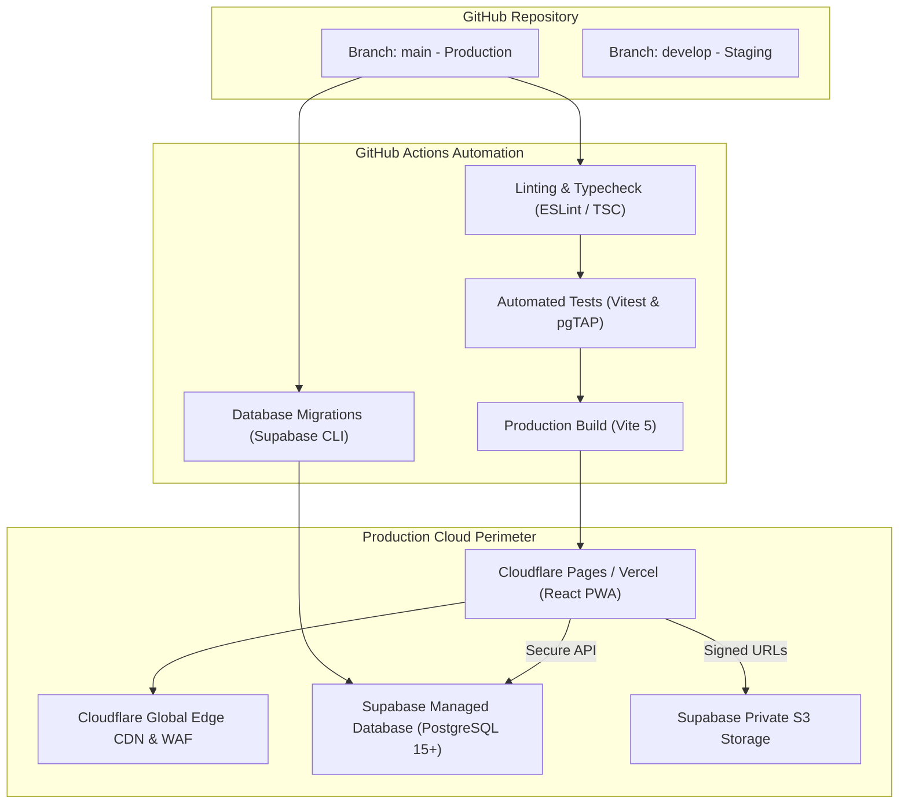
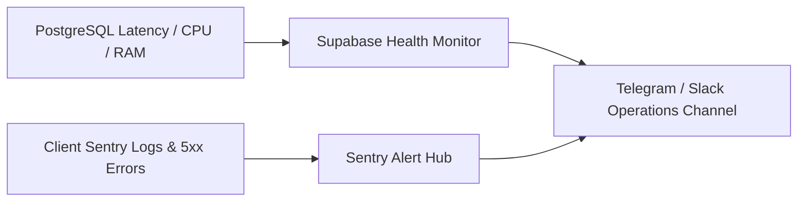

# Bachelor Home ERP — Production Deployment & DevOps Runbook
**Version:** 1.0  
**Status:** Approved Operational Runbook  
**Cloud Hosting:** Cloudflare Pages / Vercel (Frontend PWA) + Supabase Platform (Backend & Database)  
**Target Environments:** Development, Staging, Production  
**Derived From:** PRD v3.0 & Technical Architecture Document  

---

## 1. Cloud Architecture & Infrastructure Blueprint



---

## 2. Environment Matrix & Secret Configuration

| Environment | Purpose | Frontend Domain | Database Host |
| :--- | :--- | :--- | :--- |
| **Development** | Local engineering & prototyping | `http://localhost:5173` | Supabase Local CLI (`127.0.0.1:54322`) |
| **Staging** | QA verification & stakeholder demo | `https://staging.bachelorhome.com` | Supabase Staging Project |
| **Production** | Live daily operations & real money | `https://app.bachelorhome.com` | Supabase Production Project (Multi-AZ) |

### 2.1 Environment Variables Configuration

#### `.env.production` (Client-Safe Variables)
```ini
# Supabase Public API Gateway
VITE_SUPABASE_URL=https://xyzcompanyproject.supabase.co
VITE_SUPABASE_ANON_KEY=eyJhbGciOiJIUzI1NiIsInR5cCI6IkpXVCJ9...

# Application Configuration
VITE_APP_NAME="Bachelor Home ERP"
VITE_DEFAULT_LOCALE=bn
VITE_TIMEZONE=Asia/Dhaka
VITE_CURRENCY_SYMBOL=৳
VITE_ENABLE_MEAL_MODULE=true
```

#### GitHub Secrets / CI Pipeline Variables (Strictly Confidential)
```ini
# Database Migration Secret
SUPABASE_ACCESS_TOKEN=sbp_0123456789abcdef...
SUPABASE_DB_PASSWORD=SuperSecureProductionDbPassword_2026!
SUPABASE_PROJECT_ID=xyzcompanyproject

# Cloudflare Pages / Vercel Deploy Token
CLOUDFLARE_API_TOKEN=cf_deploy_token_...
CLOUDFLARE_ACCOUNT_ID=cf_acc_...
```

> [!CAUTION]
> The `SUPABASE_SERVICE_ROLE_KEY` must **NEVER** be prefixed with `VITE_` or included in frontend client code. It is reserved exclusively for trusted backend runners and automated database migration tasks.

---

## 3. Database Migration & Provisioning Workflow

All database schema evolutions, indexes, functions, and RLS policies are version-controlled using the **Supabase CLI**.

### 3.1 Local Development Setup
```bash
# 1. Install Supabase CLI
npm install -g supabase

# 2. Initialize project configuration
supabase init

# 3. Start local PostgreSQL, Auth, and Storage stack in Docker
supabase start

# 4. Generate new migration file for schema changes
supabase migration new initial_erp_schema
```

### 3.2 Applying Migrations to Production
Migrations are automatically applied during CI/CD deployment or manually executed via:
```bash
# Link local CLI with remote production Supabase project
supabase link --project-ref xyzcompanyproject

# Push unapplied migrations to remote PostgreSQL
supabase db push
```

### 3.3 Default Database Seed Data
Initial configuration seeds default roles, system settings, and essential categories:
```sql
-- Seed Expense Categories
INSERT INTO public.expense_categories (name, description) VALUES
('Electric Bill', 'Monthly hostel electricity grid bill'),
('Water & Gas', 'Monthly water and cooking gas expenses'),
('Internet & WiFi', 'Hostel high-speed broadband subscription'),
('Maintenance & Repairs', 'Plumbing, electrical repairs, painting'),
('Cook & Cleaner Salary', 'Monthly domestic helper compensation'),
('Cleaning Supplies', 'Brooms, harpic, detergents, floor wash'),
('Miscellaneous', 'Other unexpected hostel operational expenses')
ON CONFLICT (name) DO NOTHING;

-- Seed Income Categories
INSERT INTO public.income_categories (name, description) VALUES
('Boarder Rent', 'Monthly room and seat rent collections'),
('Security Deposit', 'Refundable security deposit at admission'),
('Guest Stay Fee', 'Overnight stay charge for boarder guests'),
('Scrap Sale', 'Old newspapers, cartons, discarded items sale')
ON CONFLICT (name) DO NOTHING;
```

---

## 4. Frontend Build & PWA Production Optimization

### 4.1 Production Build Command
```bash
npm run build
```
This triggers Vite's multi-stage compilation:
1. TypeScript strict typechecking (`tsc --noEmit`).
2. CSS purging and tree-shaking via Tailwind CSS.
3. Code-splitting into dynamic asynchronous chunks (`vendor`, `reports`, `accounting`).
4. Generating Workbox service worker (`sw.js`) and asset pre-caching manifests.

### 4.2 Security Headers (`_headers` file for Cloudflare Pages / Vercel)
```http
/*
  X-Frame-Options: DENY
  X-Content-Type-Options: nosniff
  X-XSS-Protection: 1; mode=block
  Referrer-Policy: strict-origin-when-cross-origin
  Permissions-Policy: camera=(self), geolocation=(), microphone=()
  Strict-Transport-Security: max-age=31536000; includeSubDomains; preload
  Content-Security-Policy: default-src 'self'; script-src 'self' 'unsafe-inline'; style-src 'self' 'unsafe-inline' https://fonts.googleapis.com; font-src 'self' https://fonts.gstatic.com; img-src 'self' data: blob: https://xyzcompanyproject.supabase.co; connect-src 'self' https://xyzcompanyproject.supabase.co wss://xyzcompanyproject.supabase.co;
```

---

## 5. Automated CI/CD Pipeline (GitHub Actions)

Create `.github/workflows/deploy.yml`:

```yaml
name: Production Deployment Pipeline

on:
  push:
    branches:
      - main

jobs:
  validate-and-test:
    name: Lint, Test & Security Audit
    runs-on: ubuntu-latest

    steps:
      - name: Checkout Codebase
        uses: actions/checkout@v4

      - name: Setup Node.js 20
        uses: actions/setup-node@v4
        with:
          node-version: 20
          cache: 'npm'

      - name: Install Dependencies
        run: npm ci

      - name: Run ESLint & Typecheck
        run: npm run lint && npm run typecheck

      - name: Run Unit Tests
        run: npm run test:unit

  database-migrations:
    name: Run Database Migrations
    needs: validate-and-test
    runs-on: ubuntu-latest

    steps:
      - name: Checkout Codebase
        uses: actions/checkout@v4

      - name: Setup Supabase CLI
        uses: supabase/setup-cli@v1
        with:
          version: latest

      - name: Deploy Migrations to Remote Supabase
        run: |
          supabase link --project-ref ${{ secrets.SUPABASE_PROJECT_ID }}
          supabase db push
        env:
          SUPABASE_ACCESS_TOKEN: ${{ secrets.SUPABASE_ACCESS_TOKEN }}
          SUPABASE_DB_PASSWORD: ${{ secrets.SUPABASE_DB_PASSWORD }}

  deploy-frontend:
    name: Build & Deploy Frontend PWA
    needs: database-migrations
    runs-on: ubuntu-latest

    steps:
      - name: Checkout Codebase
        uses: actions/checkout@v4

      - name: Setup Node.js 20
        uses: actions/setup-node@v4
        with:
          node-version: 20
          cache: 'npm'

      - name: Install Dependencies
        run: npm ci

      - name: Build Production Bundle
        env:
          VITE_SUPABASE_URL: ${{ secrets.VITE_SUPABASE_URL }}
          VITE_SUPABASE_ANON_KEY: ${{ secrets.VITE_SUPABASE_ANON_KEY }}
        run: npm run build

      - name: Deploy to Cloudflare Pages
        uses: cloudflare/pages-action@v1
        with:
          apiToken: ${{ secrets.CLOUDFLARE_API_TOKEN }}
          accountId: ${{ secrets.CLOUDFLARE_ACCOUNT_ID }}
          projectName: 'bachelor-home-erp'
          directory: 'dist'
          gitHubToken: ${{ secrets.GITHUB_TOKEN }}
```

---

## 6. Backup, Disaster Recovery & PITR Operations

### 6.1 Automated Backup Policies
1. **Daily Full Snapshots:** Supabase automatically creates full database dumps once every 24 hours, retained for 30 days in off-site geo-redundant storage.
2. **Point-In-Time-Recovery (PITR):** Write-Ahead Logging (WAL) captures every write operation continuously, allowing database recovery to any specified second within the past 7 days.

### 6.2 Point-In-Time Recovery Runbook
In case of accidental data corruption (e.g. faulty manual script execution):
1. Navigate to **Supabase Dashboard** ➔ **Settings** ➔ **Database** ➔ **Backups**.
2. Select **Point in Time Recovery (PITR)**.
3. Specify the exact recovery timestamp in `Asia/Dhaka` timezone (e.g., `2026-10-15 14:30:00+06:00` right before incident).
4. Initiate restore to a new cloned staging instance.
5. Verify financial ledgers and seat allocation integrity.
6. Swap production DNS/API pointers to the recovered instance.

---

## 7. Monitoring, Alerts & Incident Management



### 7.1 Alert Thresholds & Escalation

| Trigger Condition | Threshold | Notification Channel | Action Protocol |
| :--- | :--- | :--- | :--- |
| **Manager Cash Variance** | Variance $\ne$ 0 on day close | Super Admin Dashboard & Email | Flag session for review; verify physical vouchers. |
| **Database Response Latency** | $> 500$ ms for $> 3$ consecutive mins | DevOps Team (Telegram Alert) | Inspect query plan; scale compute instance if needed. |
| **Failed Automated Backup** | 1 failure occurrence | DevOps Team & Super Admin | Immediate manual pg_dump backup trigger. |
| **Cutoff Tamper Attempt** | $> 5$ rejected cutoff attempts | Security Audit Log | Investigate boarder account activity. |

### 7.2 Day-to-Day Maintenance Checklist
- **Nightly (10:05 PM Asia/Dhaka):** Verify automated lock on tomorrow's meal selections.
- **Nightly (11:59 PM Asia/Dhaka):** Verify all active managers have submitted daily cash closing sessions.
- **Weekly (Friday 08:00 AM):** Review system audit logs for unauthorized role modification attempts or voided receipts.
- **Monthly (1st Day):** Run automated recurring rent billing generation script for active allocations.
