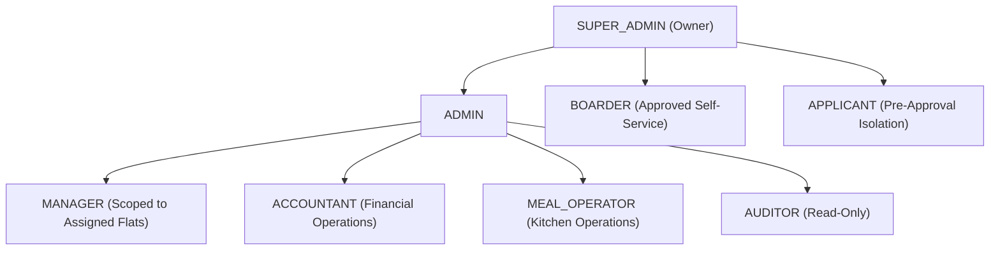
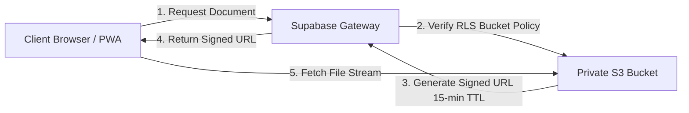

# Bachelor Home ERP — Security & Authorization Blueprint
**Version:** 1.0  
**Status:** Approved Security Architecture  
**Target Environment:** Supabase GoTrue Auth, PostgreSQL Row Level Security (RLS), S3 Private Storage  
**Derived From:** PRD v3.0 & Technical Architecture Document  

---

## 1. Security Architecture & Threat Model

Bachelor Home ERP operates on a **Zero-Trust Client** architecture. The frontend application (React PWA) runs in untrusted user environments (browsers, personal mobile devices). All security boundaries, business validations, and data privacy rules are strictly enforced at the database and API gateway layer.

```mermaid
graph TD
    subgraph Untrusted_Zone [Untrusted Client Zone]
        ClientApp["React PWA / Browser"]
    end

    subgraph Security_Perimeter [Security Perimeter Gateway]
        WAF["Cloudflare WAF / DDoS & SSL Termination"]
        Kong["Kong API Gateway (Rate Limiting & CORS)"]
        GoTrue["Supabase Auth / GoTrue (JWT Verification)"]
    end

    subgraph Enforcement_Zone [Database Enforcement Layer (Zero Trust)]
        JWTClaims["auth.jwt() Claims Extraction"]
        RLS["PostgreSQL Row Level Security Engine"]
        SecDef["SECURITY DEFINER RPC Functions"]
        AuditEngine["Automated Audit Logging Triggers"]
    end

    subgraph Storage_Perimeter [Private Storage Vault]
        S3Storage["Supabase Storage (Signed URLs Only)"]
    end

    ClientApp -->|HTTPS / WSS| WAF
    WAF --> Kong
    Kong --> GoTrue
    Kong -->|Bearer JWT| RLS
    Kong --> SecDef
    RLS --> AuditEngine
    Kong --> S3Storage
```

### 1.1 STRIDE Threat Analysis & Mitigation

| Threat Category | Potential Attack Vector | System Defense & Mitigation |
| :--- | :--- | :--- |
| **Spoofing** | Impersonating another manager or boarder | Supabase Auth with cryptographically signed ES256/RS256 JWTs. Session tokens stored in secure `HttpOnly` cookies / local storage with automatic token refresh. |
| **Tampering** | Modifying client clock to toggle meals after 10:00 PM; editing receipts | Database engine enforces cutoff using `timezone('Asia/Dhaka', now())`. Receipts and finalized cash sessions are protected by immutable triggers and RLS. |
| **Repudiation** | Denying collection of cash or handover of funds | Two-phase commit on handovers; immutable `audit_logs` record actor UUID, timestamp, client IP, and old/new JSON payloads. |
| **Information Disclosure** | Managers viewing flats they are not assigned to; boarders inspecting other boarders' dues | Granular RLS policies using `user_flat_assignments` and `boarders.user_id = auth.uid()`. |
| **Denial of Service** | Flooding meal toggles or report downloads | Kong API Gateway rate limiting, PostgreSQL statement timeouts, connection pooling via Supavisor. |
| **Elevation of Privilege** | Boarder changing role to ADMIN via API request | `profiles.role` column cannot be updated by normal users; updates restricted to `SUPER_ADMIN` via strict RLS policy. |

---

## 2. Authentication & Identity Management

### 2.1 Supabase GoTrue Integration
- **Authentication Method:** Email & Password / Phone OTP.
- **Session Tokens:** Short-lived JWT access tokens (1 hour expiry) with long-lived rotating refresh tokens (30 days).
- **Session Invalidation:** Immediately upon user deactivation (`profiles.is_active = false`), database functions reject incoming requests even if the JWT has not yet expired.

### 2.2 JWT Payload Structure
```json
{
  "sub": "b2f6b8a2-2b6d-4b7e-971c-3b03610a8b9f",
  "aud": "authenticated",
  "role": "authenticated",
  "email": "manager.dhanmondi@bachelorhome.com",
  "app_metadata": {
    "provider": "email"
  },
  "user_metadata": {
    "full_name": "Rahim Ahmed"
  },
  "exp": 1792070400
}
```

---

## 3. Role-Based Access Control (RBAC) & Scope Matrix

The system features 8 distinct roles with fine-grained multi-level scoping:



### 3.1 Permission Matrix by Operation

| Entity / Action | SUPER_ADMIN | ADMIN | MANAGER | ACCOUNTANT | MEAL_OPERATOR | BOARDER | APPLICANT | AUDITOR |
| :--- | :---: | :---: | :---: | :---: | :---: | :---: | :---: | :---: |
| **System Settings** | Full | View | None | None | None | None | None | View |
| **Buildings & Flats** | Full | Full | View (Assigned) | View | View (Assigned) | View (Own) | None | View |
| **Seat Allocation** | Full | Full | Create/View (Assigned) | View | None | None | None | View |
| **Boarder Registration** | Full | Full | Approve (Assigned) | View | None | None | Create (Self) | View |
| **Collect Receipts** | Full | Full | Create (Assigned) | Full | None | None | None | View |
| **Void/Reverse Receipt**| Full | None | None | Full (Audited) | None | None | None | View |
| **Record Expenses** | Full | Full | Create (Assigned) | Full | None | None | None | View |
| **Daily Cash Close** | Full | Review | Create/Submit (Self) | Review | None | None | None | View |
| **Cash Handover** | Full | Full | Initiate/Accept (Self)| View | None | None | None | View |
| **Meal Toggle** | Override | Override | View (Assigned) | None | None | Edit (Self <10PM)| None | View |
| **Kitchen List** | Full | Full | View (Assigned) | None | Full (Assigned) | None | None | View |
| **16 Financial Reports**| Full | Full | Scope (Assigned) | Full | None | None | None | View |
| **Audit Logs** | Full | View | None | None | None | None | None | Full |

---

## 4. Row Level Security (RLS) Implementation

### 4.1 RLS Security Helper Functions
These helper functions avoid redundant subqueries and execute with cached plans:

```sql
-- 1. Get current authenticated user's role
CREATE OR REPLACE FUNCTION auth.current_user_role()
RETURNS VARCHAR
LANGUAGE sql
STABLE
SECURITY DEFINER
SET search_path = public, pg_temp
AS $$
    SELECT role::VARCHAR FROM public.profiles WHERE id = auth.uid();
$$;

-- 2. Check if user has global administrative access
CREATE OR REPLACE FUNCTION auth.is_admin_or_owner()
RETURNS BOOLEAN
LANGUAGE sql
STABLE
SECURITY DEFINER
SET search_path = public, pg_temp
AS $$
    SELECT EXISTS (
        SELECT 1 FROM public.profiles 
        WHERE id = auth.uid() AND role IN ('SUPER_ADMIN', 'ADMIN') AND is_active = true
    );
$$;

-- 3. Check if user is assigned to a specific flat
CREATE OR REPLACE FUNCTION auth.has_flat_access(p_flat_id UUID)
RETURNS BOOLEAN
LANGUAGE sql
STABLE
SECURITY DEFINER
SET search_path = public, pg_temp
AS $$
    SELECT auth.is_admin_or_owner() OR EXISTS (
        SELECT 1 FROM public.user_flat_assignments 
        WHERE user_id = auth.uid() AND flat_id = p_flat_id
    );
$$;
```

---

### 4.2 Comprehensive RLS Policies by Table

#### 1. `profiles` Table
```sql
ALTER TABLE public.profiles ENABLE ROW LEVEL SECURITY;

-- Everyone can read their own profile; Admins and Auditors can view all
CREATE POLICY profiles_select_policy ON public.profiles
FOR SELECT TO authenticated
USING (
    id = auth.uid() 
    OR auth.current_user_role() IN ('SUPER_ADMIN', 'ADMIN', 'AUDITOR', 'ACCOUNTANT')
);

-- Users can update only their own non-sensitive profile details (e.g. language)
CREATE POLICY profiles_update_self ON public.profiles
FOR UPDATE TO authenticated
USING (id = auth.uid())
WITH CHECK (
    id = auth.uid() 
    AND role = (SELECT role FROM public.profiles WHERE id = auth.uid()) -- Role tampering prevented
);

-- Only SUPER_ADMIN can alter user roles or activate/deactivate accounts
CREATE POLICY profiles_super_admin_all ON public.profiles
FOR ALL TO authenticated
USING (auth.current_user_role() = 'SUPER_ADMIN')
WITH CHECK (auth.current_user_role() = 'SUPER_ADMIN');
```

#### 2. `boarders` Table (Strict Pre-Approval Isolation)
```sql
ALTER TABLE public.boarders ENABLE ROW LEVEL SECURITY;

-- Boarder can read only their own record; Staff can read based on role
CREATE POLICY boarders_select_policy ON public.boarders
FOR SELECT TO authenticated
USING (
    user_id = auth.uid() 
    OR auth.current_user_role() IN ('SUPER_ADMIN', 'ADMIN', 'ACCOUNTANT', 'AUDITOR')
    OR (
        auth.current_user_role() = 'MANAGER' AND EXISTS (
            SELECT 1 FROM public.allocations a
            JOIN public.seats s ON s.id = a.seat_id
            JOIN public.rooms r ON r.id = s.room_id
            JOIN public.user_flat_assignments ufa ON ufa.flat_id = r.flat_id
            WHERE a.boarder_id = public.boarders.id AND ufa.user_id = auth.uid()
        )
    )
);

-- Prospective applicants can insert their own application
CREATE POLICY applicant_insert_policy ON public.boarders
FOR INSERT TO authenticated
WITH CHECK (
    user_id = auth.uid() 
    AND status = 'PENDING'
);

-- Boarders can update their own contact details while PENDING
CREATE POLICY boarder_self_update_pending ON public.boarders
FOR UPDATE TO authenticated
USING (user_id = auth.uid() AND status = 'PENDING')
WITH CHECK (user_id = auth.uid() AND status = 'PENDING');
```

#### 3. `receipts` & `receipt_allocations` Table
```sql
ALTER TABLE public.receipts ENABLE ROW LEVEL SECURITY;
ALTER TABLE public.receipt_allocations ENABLE ROW LEVEL SECURITY;

-- Boarders see only their own receipts; Staff see receipts based on scope
CREATE POLICY receipts_select_policy ON public.receipts
FOR SELECT TO authenticated
USING (
    boarder_id IN (SELECT id FROM public.boarders WHERE user_id = auth.uid())
    OR auth.current_user_role() IN ('SUPER_ADMIN', 'ADMIN', 'ACCOUNTANT', 'AUDITOR')
    OR (auth.current_user_role() = 'MANAGER' AND received_by = auth.uid())
);

-- Only Managers, Accountants, and Admins can create receipts
CREATE POLICY receipts_insert_policy ON public.receipts
FOR INSERT TO authenticated
WITH CHECK (
    auth.current_user_role() IN ('SUPER_ADMIN', 'ADMIN', 'MANAGER', 'ACCOUNTANT')
    AND received_by = auth.uid()
);

-- Receipts cannot be deleted or directly modified (Immutable ledger)
CREATE POLICY receipts_no_direct_update ON public.receipts
FOR UPDATE TO authenticated USING (false);

CREATE POLICY receipts_no_direct_delete ON public.receipts
FOR DELETE TO authenticated USING (false);
```

#### 4. `manager_cash_sessions` Table
```sql
ALTER TABLE public.manager_cash_sessions ENABLE ROW LEVEL SECURITY;

-- Managers can view only their own cash sessions; Admins/Auditors can view all
CREATE POLICY cash_sessions_select_policy ON public.manager_cash_sessions
FOR SELECT TO authenticated
USING (
    manager_id = auth.uid()
    OR auth.current_user_role() IN ('SUPER_ADMIN', 'ADMIN', 'ACCOUNTANT', 'AUDITOR')
);

-- Managers can update their session only while it is OPEN or REOPENED
CREATE POLICY cash_sessions_update_policy ON public.manager_cash_sessions
FOR UPDATE TO authenticated
USING (
    (manager_id = auth.uid() AND status IN ('OPEN', 'REOPENED'))
    OR auth.current_user_role() IN ('SUPER_ADMIN', 'ADMIN')
)
WITH CHECK (
    (manager_id = auth.uid() AND status IN ('OPEN', 'SUBMITTED'))
    OR auth.current_user_role() IN ('SUPER_ADMIN', 'ADMIN')
);
```

#### 5. `meal_selections` Table
```sql
ALTER TABLE public.meal_selections ENABLE ROW LEVEL SECURITY;

-- Viewable by boarder (self), kitchen operators (assigned flats), and admins
CREATE POLICY meal_selections_select_policy ON public.meal_selections
FOR SELECT TO authenticated
USING (
    boarder_id IN (SELECT id FROM public.boarders WHERE user_id = auth.uid())
    OR auth.is_admin_or_owner()
    OR auth.has_flat_access(flat_id)
);

-- Direct client INSERT/UPDATE/DELETE is blocked. All changes must use the RPC function: fn_toggle_meal_selection()
CREATE POLICY meal_selections_rpc_only_insert ON public.meal_selections
FOR INSERT TO authenticated WITH CHECK (false);

CREATE POLICY meal_selections_rpc_only_update ON public.meal_selections
FOR UPDATE TO authenticated USING (false);
```

---

## 5. Storage Vault Security (Supabase Storage)

Hostel documents (NID copies, lease agreements, expense receipts) are stored in private Supabase Storage buckets. Direct public URLs are blocked.



### 5.1 Storage Buckets Configuration

| Bucket Name | Access Level | Permitted Uploaders | Allowed File Types | Max File Size |
| :--- | :--- | :--- | :--- | :--- |
| `boarder-documents` | Strictly Private | Boarder (Own), Admin | PDF, JPEG, PNG, WEBP | 5 MB |
| `avatars` | Authenticated Read | Profile Owner, Admin | JPEG, PNG, WEBP | 2 MB |
| `payment-vouchers` | Strictly Private | Manager, Accountant, Admin | PDF, JPEG, PNG | 10 MB |
| `expense-receipts` | Strictly Private | Manager, Accountant, Admin | PDF, JPEG, PNG | 10 MB |

### 5.2 Storage Access Policies (PostgreSQL Storage Schema)
```sql
-- Policy: Only boarder and authorized admin can access identity documents
CREATE POLICY "Private boarder document access"
ON storage.objects FOR SELECT TO authenticated
USING (
    bucket_id = 'boarder-documents' AND (
        (storage.foldername(name))[1] = auth.uid()::text
        OR auth.is_admin_or_owner()
    )
);

-- Policy: Only managers and accountants can upload expense vouchers
CREATE POLICY "Expense voucher upload policy"
ON storage.objects FOR INSERT TO authenticated
WITH CHECK (
    bucket_id = 'expense-receipts' 
    AND auth.current_user_role() IN ('SUPER_ADMIN', 'ADMIN', 'MANAGER', 'ACCOUNTANT')
);
```

---

## 6. Financial Immutability & Anti-Tamper Safeguards

1. **No Silent Deletions:** No `DELETE` operations are permitted on `receipts`, `boarder_charges`, `expenses`, or `allocations`.
2. **Reversal/Void Workflow:** To cancel a receipt, an authorized user executes `fn_void_receipt()`. The original receipt is marked `is_void = true`, the allocated charges are reinstated, and an offsetting ledger reversal entry is recorded.
3. **Double Counting Prevention:** Financial views strictly filter out internal account transfers (`account_transfers`), cash handovers (`cash_handovers`), and owner deposits (`owner_deposits`) from operating revenue and expense totals.
4. **Time-Lock on Cutoffs:** The 10:00 PM cutoff for next-day meals is evaluated via the server's PostgreSQL clock configured to `Asia/Dhaka`. Client device clock changes have zero effect on cutoff evaluation.

---

## 7. Audit & Non-Repudiation Architecture

The `public.audit_logs` table functions as an immutable ledger. Any INSERT, UPDATE, DELETE, VOID, or OVERRIDE operation on core domain tables triggers automatic capture:

```sql
CREATE OR REPLACE FUNCTION public.fn_audit_trigger()
RETURNS TRIGGER
LANGUAGE plpgsql
SECURITY DEFINER
AS $$
DECLARE
    v_old JSONB := NULL;
    v_new JSONB := NULL;
    v_action audit_action;
BEGIN
    IF TG_OP = 'INSERT' THEN
        v_action := 'INSERT';
        v_new := to_jsonb(NEW);
    ELSIF TG_OP = 'UPDATE' THEN
        v_action := 'UPDATE';
        v_old := to_jsonb(OLD);
        v_new := to_jsonb(NEW);
    ELSIF TG_OP = 'DELETE' THEN
        v_action := 'DELETE';
        v_old := to_jsonb(OLD);
    END IF;

    INSERT INTO public.audit_logs (
        table_name, record_id, action, old_data, new_data, actor_id
    )
    VALUES (
        TG_TABLE_NAME,
        COALESCE(NEW.id, OLD.id),
        v_action,
        v_old,
        v_new,
        auth.uid()
    );

    RETURN COALESCE(NEW, OLD);
END;
$$;

-- Attach Audit Triggers to Critical Tables
CREATE TRIGGER trg_audit_allocations
AFTER INSERT OR UPDATE OR DELETE ON public.allocations
FOR EACH ROW EXECUTE FUNCTION public.fn_audit_trigger();

CREATE TRIGGER trg_audit_receipts
AFTER INSERT OR UPDATE ON public.receipts
FOR EACH ROW EXECUTE FUNCTION public.fn_audit_trigger();

CREATE TRIGGER trg_audit_expenses
AFTER INSERT OR UPDATE ON public.expenses
FOR EACH ROW EXECUTE FUNCTION public.fn_audit_trigger();
```

---

## 8. API Keys & Environment Security

| Key Name | Secret / Public | Location | Allowed Permissions |
| :--- | :--- | :--- | :--- |
| `VITE_SUPABASE_URL` | Public | Client Web / PWA | PostgREST & Auth endpoint routing |
| `VITE_SUPABASE_ANON_KEY` | Public | Client Web / PWA | Authenticated via JWT; strictly constrained by RLS |
| `SUPABASE_SERVICE_ROLE_KEY` | **Strictly Secret** | Backend CI/CD & Migration Runners | Bypasses RLS; **NEVER** bundled into frontend code |
| `DATABASE_URL` | **Strictly Secret** | Backend Server / Migrations | Direct PostgreSQL connection string |

### 8.1 Key Protection Rules
- The `SUPABASE_SERVICE_ROLE_KEY` is added to `.gitignore` and enforced via pre-commit secret scanning hooks.
- Supabase CORS settings restrict origin requests strictly to the production domain and authenticated PWA origins.
