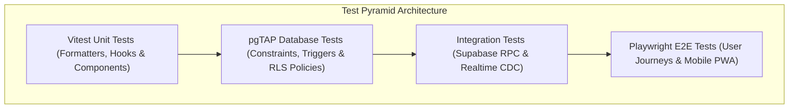

# Bachelor Home ERP — Quality Assurance & Test Plan
**Version:** 1.0  
**Status:** Approved Test Strategy  
**Standard Timezone:** `Asia/Dhaka` (UTC+6)  
**Testing Frameworks:** Vitest, React Testing Library, pgTAP (Database/RLS), Playwright (E2E)  
**Derived From:** PRD v3.0 (Section 15: Testing and Acceptance Criteria)  

---

## 1. Quality Strategy & Objectives

The Bachelor Home ERP test strategy ensures zero financial discrepancies, non-bypassable security barriers (Zero-Trust RLS), exact enforcement of the 10:00 PM Asia/Dhaka meal cutoff, and seamless PWA usability on desktop and mobile devices.



---

## 2. Acceptance Criteria & Test Scenarios (PRD §15 Matrix)

### 2.1 Finance, Receipts & Manager Cash Custody (PRD §15.1)

| Test ID | Test Scenario | Execution Method | Expected Result | Pass / Fail Criteria |
| :--- | :--- | :--- | :--- | :--- |
| **FIN-01** | Single Receipt Count | Integration / SQL | A single receipt is counted in daily collection and cash reports exactly once. | Zero double-counting across aggregation views. |
| **FIN-02** | Opening Cash Carryover | RPC Test | Today's session opening cash automatically seeds from yesterday's closing cash. | `opening_cash` equals previous session's final balance. |
| **FIN-03** | Owner Cash Deposit | RPC Test | Manager deposits cash to owner; manager cash balance decreases, owner account increases. | No duplicate income or expense entry created. |
| **FIN-04** | Cash Handover (Two-Party) | E2E / RPC | Sender initiates handover of 5,000 BDT. Receiver confirms receipt. | Balances update only after receiver confirms; zero impact on income/expense. |
| **FIN-05** | Cash Variance Calculation | Integration / RPC | Expected closing = 15,000 BDT. Counted = 14,500 BDT. | Variance automatically computes to -500 BDT. |
| **FIN-06** | Mandatory Variance Explanation | RPC Test | Submit closing with non-zero variance and empty explanation. | Request rejected with SQL error code `P0001`. |
| **FIN-07** | Finalized Session Immutability | SQL / RLS | Attempt direct SQL `UPDATE` on `manager_cash_sessions` where `status = 'APPROVED'`. | Operation rejected; records locked. |
| **FIN-08** | Partial Payment Allocation | RPC Test | Monthly rent 5,000 BDT. Boarder pays 3,000 BDT. | Charge marked `PARTIALLY_PAID`, due amount becomes 2,000 BDT. |

---

### 2.2 Accommodation & Seat Allocation (PRD §15.2)

| Test ID | Test Scenario | Execution Method | Expected Result | Pass / Fail Criteria |
| :--- | :--- | :--- | :--- | :--- |
| **ACC-01** | Arbitrary Limit Freedom | Stress Test | Seed 50 buildings, 200 flats, 800 rooms, 3,000 seats. | Database and UI navigate without hard-coded limits. |
| **ACC-02** | Conflicting Seat Allocation | pgTAP | Attempt to insert a second `ACTIVE` allocation on the same seat. | Blocked by `idx_unique_active_seat_allocation` constraint. |
| **ACC-03** | Historical Rent Preservation | Integration | Seat default rent updated from 4,500 to 5,000 BDT. | Existing active allocation maintains agreed 4,500 BDT terms. |
| **ACC-04** | Vacancy Synchronization | Database Trigger | Allocation ended or cancelled. | Seat status automatically flips from `OCCUPIED` to `AVAILABLE`. |

---

### 2.3 Meals & 10:00 PM Cutoff Engine (PRD §15.3)

| Test ID | Test Scenario | Execution Method | Expected Result | Pass / Fail Criteria |
| :--- | :--- | :--- | :--- | :--- |
| **MEL-01** | Self-Service Isolation | RLS Test | Boarder A attempts to update meal selection for Boarder B. | RLS policy denies access with 403 Forbidden. |
| **MEL-02** | Allowed Next-Day Toggle (< 10 PM) | RPC Test | Current time 21:55 Asia/Dhaka. Boarder toggles tomorrow's dinner. | Database updates record; change audit logged. |
| **MEL-03** | Blocked Next-Day Toggle (>= 10 PM) | RPC Test | Current time 22:00:01 Asia/Dhaka. Boarder toggles tomorrow's dinner. | Server throws exception: `10:00 PM cutoff reached`. |
| **MEL-04** | Admin Cutoff Override | RPC Test | Admin toggles meal after 10 PM with documented override reason. | Allowed; marked `is_override = true` with admin ID logged. |
| **MEL-05** | Realtime Dashboard Broadcast | Playwright E2E | Boarder toggles meal; kitchen monitor open on separate screen. | Kitchen monitor meal count increments within < 1.5 seconds. |
| **MEL-06** | Duplicate Selection Prevention | SQL / Constraint | Attempt duplicate insertion for same boarder and date. | Handled via UPSERT (`ON CONFLICT (boarder_id, meal_date)`). |

---

### 2.4 Access Control & Security Boundaries (PRD §15.4)

| Test ID | Test Scenario | Execution Method | Expected Result | Pass / Fail Criteria |
| :--- | :--- | :--- | :--- | :--- |
| **SEC-01** | Applicant Isolation | RLS Test | User with `APPLICANT` role attempts to query `/rest/v1/seats` or `/rest/v1/expenses`. | Empty array or 403 Forbidden returned. |
| **SEC-02** | Boarder Cross-Read Block | RLS Test | Boarder 1 queries ledger of Boarder 2 via ID manipulation. | Zero records returned (RLS filtered). |
| **SEC-03** | Manager Flat-Scoping | RLS Test | Manager of Flat 1 queries rooms of Flat 2. | Filtered out by `user_flat_assignments` policy. |
| **SEC-04** | Secret Key Leak Prevention | Static Analysis | Scan frontend production bundle for `SUPABASE_SERVICE_ROLE_KEY`. | Zero occurrences found. |
| **SEC-05** | Audit Trail Creation | SQL Trigger | Manager modifies boarder profile or records receipt. | Corresponding row added to `public.audit_logs`. |

---

## 3. Database & RLS Testing Suite (`pgTAP`)

Database tests execute in a clean PostgreSQL test harness using `pgTAP`.

```sql
-- pgTAP Test Script: test_rls_and_constraints.sql
BEGIN;
SELECT plan(6);

-- 1. Verify seat uniqueness constraint exists
SELECT has_index('public', 'allocations', 'idx_unique_active_seat_allocation', 
                 'Active seat allocation partial index must exist');

-- 2. Verify RLS is enabled on critical tables
SELECT table_has_rls('public', 'boarders', 'Boarders table must have RLS enabled');
SELECT table_has_rls('public', 'receipts', 'Receipts table must have RLS enabled');
SELECT table_has_rls('public', 'meal_selections', 'Meal selections must have RLS enabled');

-- 3. Test Active Allocation Conflict Constraint
-- Seed building, flat, room, seat, and boarder
INSERT INTO public.buildings (id, building_code, name, address) 
VALUES ('11111111-1111-1111-1111-111111111111', 'B1', 'Test Building', 'Dhaka');

INSERT INTO public.flats (id, building_id, flat_code, name) 
VALUES ('22222222-2222-2222-2222-222222222222', '11111111-1111-1111-1111-111111111111', 'F1', 'Flat 1');

INSERT INTO public.rooms (id, flat_id, room_code, name) 
VALUES ('33333333-3333-3333-3333-333333333333', '22222222-2222-2222-2222-222222222222', 'R1', 'Room 1');

INSERT INTO public.seats (id, room_id, seat_code, seat_name, default_rent) 
VALUES ('44444444-4444-4444-4444-444444444444', '33333333-3333-3333-3333-333333333333', 'S1', 'Seat 1', 5000.00);

INSERT INTO public.boarders (id, boarder_code, full_name, phone_number, guardian_name, guardian_phone, permanent_address, admission_date, status)
VALUES 
('55555555-5555-5555-5555-555555555555', 'B1', 'Boarder One', '01700000001', 'G1', '01800000001', 'Address 1', '2026-10-01', 'ACTIVE'),
('66666666-6666-6666-6666-666666666666', 'B2', 'Boarder Two', '01700000002', 'G2', '01800000002', 'Address 2', '2026-10-01', 'ACTIVE');

-- Insert first allocation
INSERT INTO public.allocations (boarder_id, seat_id, monthly_rent, start_date, status)
VALUES ('55555555-5555-5555-5555-555555555555', '44444444-4444-4444-4444-444444444444', 5000.00, '2026-10-01', 'ACTIVE');

-- 4. Expect failure when inserting conflicting second active allocation
SELECT throws_ok(
    $$ INSERT INTO public.allocations (boarder_id, seat_id, monthly_rent, start_date, status)
       VALUES ('66666666-6666-6666-6666-666666666666', '44444444-4444-4444-4444-444444444444', 5000.00, '2026-10-01', 'ACTIVE') $$,
    '23505', -- Unique violation error code
    NULL,
    'Conflicting active seat allocation must trigger a unique constraint violation'
);

-- 5. Verify Seat Trigger Flipped Status to OCCUPIED
SELECT is(
    (SELECT status::text FROM public.seats WHERE id = '44444444-4444-4444-4444-444444444444'),
    'OCCUPIED',
    'Seat status must automatically transition to OCCUPIED'
);

SELECT * FROM finish();
ROLLBACK;
```

---

## 4. End-to-End Automated Testing (Playwright)

### 4.1 Test Scenario: 10 PM Meal Cutoff & Realtime Update
```typescript
import { test, expect } from '@playwright/test';

test.describe('Meal Module: Cutoff & Realtime Tests', () => {
  test('Boarder is blocked from changing next-day meals after 10:00 PM Asia/Dhaka', async ({ page }) => {
    // 1. Mock system time to 10:05 PM Asia/Dhaka
    await page.clock.setFixedTime(new Date('2026-10-15T22:05:00+06:00'));

    // 2. Login as active boarder
    await page.goto('/login');
    await page.fill('input[type="email"]', 'boarder@bachelorhome.com');
    await page.fill('input[type="password"]', 'BoarderPass123!');
    await page.click('button[type="submit"]');

    // 3. Navigate to Meal Selection portal
    await page.goto('/meals/self-service');
    await expect(page.locator('text=Next-Day Meal Selection (Tomorrow)')).toBeVisible();

    // 4. Verify cutoff banner is active
    await expect(page.locator('text=Locked (10:00 PM Cutoff Passed)')).toBeVisible();

    // 5. Attempt toggle and verify error toast
    const dinnerToggle = page.locator('#dinner-toggle-tomorrow');
    await expect(dinnerToggle).toBeDisabled();
  });

  test('Manager screen updates in realtime when boarder toggles meal before cutoff', async ({ browser }) => {
    // Context 1: Kitchen / Manager View
    const managerContext = await browser.newContext();
    const managerPage = await managerContext.newPage();
    await managerPage.goto('/login');
    await managerPage.fill('input[type="email"]', 'manager@bachelorhome.com');
    await managerPage.fill('input[type="password"]', 'ManagerPass123!');
    await managerPage.click('button[type="submit"]');
    await managerPage.goto('/meals/kitchen-summary');

    const initialLunchCount = await managerPage.locator('#flat-2a-lunch-count').innerText();

    // Context 2: Boarder View
    const boarderContext = await browser.newContext();
    const boarderPage = await boarderContext.newPage();
    await boarderPage.goto('/login');
    await boarderPage.fill('input[type="email"]', 'boarder@bachelorhome.com');
    await boarderPage.fill('input[type="password"]', 'BoarderPass123!');
    await boarderPage.click('button[type="submit"]');
    await boarderPage.goto('/meals/self-service');

    // Toggle lunch ON
    await boarderPage.click('#lunch-toggle-tomorrow');
    await expect(boarderPage.locator('text=Meal preference updated')).toBeVisible();

    // Verify Manager page updated automatically without manual page refresh
    await expect(managerPage.locator('#flat-2a-lunch-count')).not.toHaveText(initialLunchCount, { timeout: 3000 });
  });
});
```

---

## 5. PWA Usability & Offline Resilience Tests

| Test Case | Procedure | Acceptance Standard |
| :--- | :--- | :--- |
| **PWA-01: Manifest Verification** | Inspect `/manifest.json` via Chrome DevTools Lighthouse audit. | Score 100%; valid icons (192px, 512px), `start_url`, and theme colors. |
| **PWA-02: Offline App Shell** | Disconnect network after initial load and refresh page. | App shell, navigation header, and cached lists render gracefully without browser crash screen. |
| **PWA-03: Offline Mutation Trap** | Attempt to post a cash receipt or meal toggle while completely offline. | Operation is cleanly paused with user alert: *"No internet connection. Financial entries cannot be submitted offline."* |
| **PWA-04: Language Switch Persistence** | Switch language to বাংলা (`bn`), close app, reopen. | App opens directly in বাংলা with saved preference from `localStorage`. |

---

## 6. Defect Classification & Release Gate Criteria

### 6.1 Severity Levels
- **P0 (Critical Blocker):** Financial discrepancy, duplicate receipt generation, RLS leak between boarders/flats, bypass of 10 PM cutoff. *(Release halted)*.
- **P1 (Major):** Broken report export (PDF/Excel), realtime sync failure requiring manual refresh, failed PWA installation. *(Must fix before production)*.
- **P2 (Minor):** Minor UI styling misalignments, missing Bengali localization strings. *(Fixable in minor patch)*.

### 6.2 Production Release Sign-Off Checklist
- [ ] 100% pass rate on `pgTAP` RLS and constraint test suite.
- [ ] Automated Playwright test suite passes on both Desktop Chrome and Mobile WebKit viewports.
- [ ] Financial balance formula test passes with zero rounding discrepancy.
- [ ] Pre-launch database restoration drill verified from automated backup snapshot.
